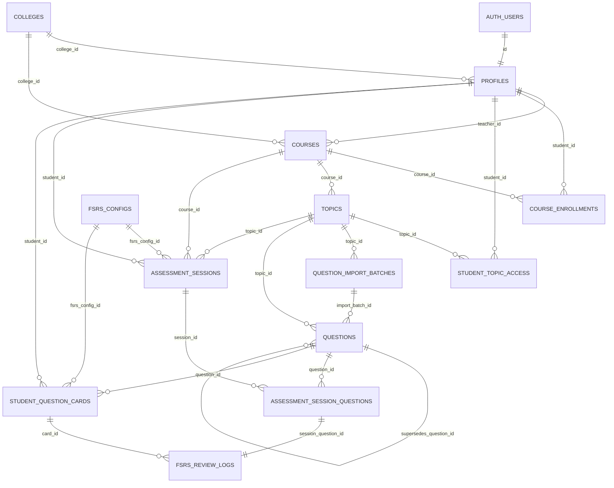

# Documentación de la base de datos

**Proyecto Supabase:** `oriol.palacios@acelera.io's Project`  
**Project ref:** `ueswxnnfklqqitjbpeha`  
**Región:** `ca-central-1`  
**PostgreSQL:** `17.6.1.147`  
**Estado:** `ACTIVE_HEALTHY`  
**Fecha de actualización:** 25 de julio de 2026

## Resumen general

La base de datos soporta una plataforma académica multiinstitución con tres roles: administrador, profesor y estudiante. Incluye gestión de colegios, usuarios, cursos, temas, asignaciones, bloqueos individuales, importación de preguntas, sesiones de evaluación y programación de repaso mediante FSRS.

Estado actual:

- 14 tablas en el esquema `public`.
- 7 vistas con `security_invoker = true`.
- 27 políticas RLS.
- 17 funciones auxiliares en `private`.
- 8 funciones de validación y triggers en `public`.
- 17 triggers.
- 50 índices.
- RLS activo en las 14 tablas.
- No existen Edge Functions desplegadas todavía.
- Las tablas se encuentran actualmente sin datos permanentes.

## Esquemas

- `auth`: administrado por Supabase Auth; contiene `auth.users`.
- `public`: tablas, vistas, enums y funciones de validación expuestas a la aplicación bajo RLS.
- `private`: funciones internas de autorización usadas como guards por RLS y por el backend.

## Tipos enumerados

| Tipo | Valores |
|---|---|
| `public.app_user_role` | `admin`, `teacher`, `student` |
| `public.course_status` | `active`, `inactive`, `archived` |
| `public.enrollment_status` | `active`, `inactive` |
| `public.topic_status` | `draft`, `active`, `inactive`, `archived` |
| `public.question_status` | `draft`, `active`, `inactive`, `archived` |
| `public.import_status` | `validating`, `completed`, `failed` |
| `public.session_status` | `in_progress`, `completed`, `abandoned` |
| `public.question_selection_reason` | `due`, `new` |
| `public.fsrs_rating` | `Again`, `Good` |

## Mapa general de relaciones

# Tablas

## public.colleges

Registra las instituciones educativas que participan en la plataforma.

**RLS:** activo.

| Columna | Tipo | Nulo | Valor por defecto | Descripción |
|---|---|---:|---|---|
| `id` | `uuid` | No | `gen_random_uuid()` | Identificador principal. |
| `code` | `text` | No | — | Código único del colegio. |
| `name` | `text` | No | — | Nombre de la institución. |
| `description` | `text` | Sí | — | Descripción opcional. |
| `is_active` | `boolean` | No | `true` | Indica si la institución está activa. |
| `created_at` | `timestamptz` | No | `now()` | Fecha de creación. |
| `updated_at` | `timestamptz` | No | `now()` | Última actualización. |

### Relaciones

- Es referenciada por `public.profiles.college_id`.
- Es referenciada por `public.courses.college_id`.
- Es referenciada por `public.audit_logs.college_id`.

### Constraints

- `colleges_pkey`: `PRIMARY KEY (id)`.
- `colleges_code_not_blank`: el código no puede estar vacío.
- `colleges_name_not_blank`: el nombre no puede estar vacío.
- Índice único `colleges_code_unique_ci`: evita códigos duplicados ignorando mayúsculas, minúsculas y espacios externos.

### Políticas RLS

- `colleges_select`: administrador puede ver todos; usuarios activos solo pueden ver su propio colegio.
- `colleges_insert`: solo administrador.
- `colleges_update`: solo administrador.

---

## public.profiles

Perfil de aplicación relacionado uno a uno con `auth.users`. Contiene rol, colegio, código visible y vigencia de acceso.

**RLS:** activo.

| Columna | Tipo | Nulo | Valor por defecto | Descripción |
|---|---|---:|---|---|
| `id` | `uuid` | No | — | PK y FK hacia `auth.users.id`. |
| `college_id` | `uuid` | Sí | — | Colegio al que pertenece el usuario. |
| `role` | `public.app_user_role` | No | — | `admin`, `teacher` o `student`. |
| `user_code` | `text` | No | — | Código visible y único de acceso. |
| `full_name` | `text` | No | — | Nombre completo. |
| `is_active` | `boolean` | No | `true` | Estado general del perfil. |
| `access_valid_from` | `date` | Sí | — | Inicio de vigencia del estudiante. |
| `access_valid_until` | `date` | Sí | — | Fin de vigencia del estudiante. |
| `created_by` | `uuid` | Sí | — | Administrador que creó el perfil. |
| `created_at` | `timestamptz` | No | `now()` | Fecha de creación. |
| `updated_at` | `timestamptz` | No | `now()` | Última actualización. |

### Relaciones

- `id → auth.users.id` con `ON DELETE CASCADE`.
- `college_id → public.colleges.id` con `ON DELETE CASCADE`.
- `created_by → public.profiles.id` con `ON DELETE CASCADE`.
- Es referenciada por cursos, inscripciones, bloqueos, importaciones, preguntas, sesiones, tarjetas FSRS, logs y auditoría.

### Constraints

- `profiles_pkey`: `PRIMARY KEY (id)`.
- `profiles_access_dates_order`: la fecha inicial no puede ser posterior a la final.
- `profiles_college_required`: profesores y estudiantes deben tener `college_id`; el administrador puede no tenerlo.
- `profiles_student_dates_required`: los estudiantes deben tener ambas fechas de vigencia.
- `profiles_full_name_not_blank`: nombre no vacío.
- `profiles_user_code_not_blank`: código no vacío.
- Índice único `profiles_user_code_unique_ci`: código único sin distinguir mayúsculas/minúsculas.

### Políticas RLS

- `profiles_select`: administrador ve todos; cada usuario ve su propio perfil; un profesor ve estudiantes inscritos en sus cursos.
- `profiles_update`: solo administrador.
- La creación se realizará mediante una Edge Function administrativa, no mediante acceso directo del frontend.

---

## public.courses

Cursos pertenecientes a un solo profesor y a un solo colegio.

**RLS:** activo.

| Columna | Tipo | Nulo | Valor por defecto | Descripción |
|---|---|---:|---|---|
| `id` | `uuid` | No | `gen_random_uuid()` | Identificador del curso. |
| `college_id` | `uuid` | No | — | Colegio del curso. |
| `teacher_id` | `uuid` | No | — | Profesor propietario. |
| `name` | `text` | No | — | Nombre del curso. |
| `description` | `text` | Sí | — | Descripción opcional. |
| `status` | `public.course_status` | No | `active` | Estado del curso. |
| `created_by` | `uuid` | Sí | — | Usuario creador. |
| `created_at` | `timestamptz` | No | `now()` | Fecha de creación. |
| `updated_at` | `timestamptz` | No | `now()` | Última actualización. |

### Relaciones

- `college_id → public.colleges.id` con `ON DELETE CASCADE`.
- `teacher_id → public.profiles.id` con `ON DELETE CASCADE`.
- `created_by → public.profiles.id` con `ON DELETE CASCADE`.
- Es referenciada por `course_enrollments`, `topics` y `assessment_sessions`.

### Constraints

- `courses_pkey`: `PRIMARY KEY (id)`.
- `courses_name_not_blank`: nombre no vacío.
- Trigger de negocio: máximo 8 cursos no archivados por profesor.
- Trigger de negocio: el propietario debe tener rol `teacher` y pertenecer al mismo colegio.
- Índice único parcial `courses_teacher_name_unique_active_ci`: un profesor no puede tener dos cursos no archivados con el mismo nombre, ignorando mayúsculas/minúsculas.

### Políticas RLS

- `courses_select`: administrador ve todos; profesor ve sus cursos; estudiante vigente ve los cursos donde está inscrito.
- `courses_insert`: administrador o profesor activo creando un curso propio en su colegio.
- `courses_update`: administrador o profesor propietario; no permite reasignar el curso a otro profesor/colegio fuera de sus permisos.

---

## public.course_enrollments

Relaciona estudiantes con cursos. Un estudiante puede pertenecer a varios cursos de diferentes profesores dentro del mismo colegio.

**RLS:** activo.

| Columna | Tipo | Nulo | Valor por defecto | Descripción |
|---|---|---:|---|---|
| `id` | `uuid` | No | `gen_random_uuid()` | Identificador. |
| `course_id` | `uuid` | No | — | Curso asignado. |
| `student_id` | `uuid` | No | — | Estudiante asignado. |
| `status` | `public.enrollment_status` | No | `active` | Estado de inscripción. |
| `enrolled_by` | `uuid` | Sí | — | Usuario que realizó la asignación. |
| `enrolled_at` | `timestamptz` | No | `now()` | Fecha de inscripción. |
| `ended_at` | `timestamptz` | Sí | — | Fecha de término. |
| `created_at` | `timestamptz` | No | `now()` | Fecha de creación. |
| `updated_at` | `timestamptz` | No | `now()` | Última actualización. |

### Relaciones

- `course_id → public.courses.id` con `ON DELETE CASCADE`.
- `student_id → public.profiles.id` con `ON DELETE CASCADE`.
- `enrolled_by → public.profiles.id` con `ON DELETE CASCADE`.

### Constraints

- `course_enrollments_pkey`: `PRIMARY KEY (id)`.
- `course_enrollments_unique`: combinación única `(course_id, student_id)`.
- `course_enrollments_ended_consistency`: una inscripción activa debe tener `ended_at = NULL`.
- Trigger: el perfil debe ser estudiante y pertenecer al mismo colegio que el curso.
- Trigger: al pasar a `inactive`, establece `ended_at`; al reactivar, lo limpia.

### Políticas RLS

- `course_enrollments_select`: administrador, estudiante dueño de la inscripción o profesor propietario del curso.
- `course_enrollments_insert`: administrador o profesor autorizado para ese curso y estudiante.
- `course_enrollments_update`: administrador o profesor propietario del curso.
- `course_enrollments_delete`: únicamente el administrador puede eliminar matrículas; para bloqueos temporales se utiliza `status = inactive`.

### Eliminación de un profesor

La eliminación administrativa de un profesor comienza eliminando su cuenta de `auth.users`. La relación `profiles.id → auth.users.id` elimina su perfil y `courses.teacher_id → profiles.id` elimina en cascada todos los cursos que le pertenecen. A partir de esos cursos también se eliminan sus temas, preguntas, matrículas, sesiones, resultados, tarjetas FSRS, bloqueos y demás registros académicos dependientes.

Los perfiles de los estudiantes matriculados en esos cursos **no se eliminan**. La cascada elimina las filas de `course_enrollments` que apuntan a los cursos del profesor, pero no se propaga en sentido inverso desde una matrícula hacia el perfil del estudiante. El alumno conserva su cuenta y sus relaciones con otros profesores.

Existen dos campos de auditoría que actualmente usan `ON DELETE CASCADE` y deben considerarse:

- `profiles.created_by`: si un perfil tuviera al profesor eliminado como creador, ese perfil también sería eliminado. En el flujo administrativo actual los profesores y estudiantes son creados por un administrador, por lo que un estudiante no debería tener un profesor en este campo.
- `course_enrollments.enrolled_by`: eliminar un profesor también elimina cualquier matrícula registrada por él, incluso si excepcionalmente perteneciera a un curso de otro profesor.

Para garantizar estructuralmente que la eliminación se limite exclusivamente a los cursos propiedad del profesor, estos dos campos de auditoría deberían utilizar `ON DELETE SET NULL`. La cascada académica principal debe originarse en `courses.teacher_id`.

---

## public.topics

Temas o unidades dentro de un curso.

**RLS:** activo.

| Columna | Tipo | Nulo | Valor por defecto | Descripción |
|---|---|---:|---|---|
| `id` | `uuid` | No | `gen_random_uuid()` | Identificador. |
| `course_id` | `uuid` | No | — | Curso al que pertenece. |
| `name` | `text` | No | — | Nombre del tema. |
| `description` | `text` | Sí | — | Descripción opcional. |
| `material_url` | `text` | Sí | — | Enlace de material complementario. |
| `position` | `integer` | No | `1` | Orden del tema. |
| `status` | `public.topic_status` | No | `draft` | Estado del tema. |
| `created_by` | `uuid` | Sí | — | Usuario creador. |
| `created_at` | `timestamptz` | No | `now()` | Fecha de creación. |
| `updated_at` | `timestamptz` | No | `now()` | Última actualización. |

### Relaciones

- `course_id → public.courses.id` con `ON DELETE CASCADE`.
- `created_by → public.profiles.id` con `ON DELETE CASCADE`.
- Es referenciada por bloqueos, lotes de importación, preguntas y sesiones.

### Constraints

- `topics_pkey`: `PRIMARY KEY (id)`.
- `topics_name_not_blank`: nombre no vacío.
- `topics_position_positive`: posición mayor a cero.
- Trigger de negocio: máximo 25 temas no archivados por curso.
- Índice único parcial por `(course_id, position)` para temas no archivados.
- Índice único parcial por curso y nombre normalizado para temas no archivados.

### Políticas RLS

- `topics_select`: administrador, profesor propietario o estudiante vigente inscrito; el estudiante solo ve temas activos.
- `topics_insert`: administrador o profesor propietario del curso.
- `topics_update`: administrador o profesor propietario del curso.

---

## public.student_topic_access

Controla el bloqueo individual de un tema para un estudiante. El bloqueo no tiene fecha de expiración.

**RLS:** activo.

| Columna | Tipo | Nulo | Valor por defecto | Descripción |
|---|---|---:|---|---|
| `id` | `uuid` | No | `gen_random_uuid()` | Identificador. |
| `student_id` | `uuid` | No | — | Estudiante afectado. |
| `topic_id` | `uuid` | No | — | Tema bloqueado o habilitado. |
| `is_blocked` | `boolean` | No | `false` | Estado del bloqueo. |
| `updated_by` | `uuid` | Sí | — | Usuario que cambió el bloqueo. |
| `created_at` | `timestamptz` | No | `now()` | Fecha de creación. |
| `updated_at` | `timestamptz` | No | `now()` | Última actualización. |

### Relaciones

- `student_id → public.profiles.id` con `ON DELETE CASCADE`.
- `topic_id → public.topics.id` con `ON DELETE CASCADE`.
- `updated_by → public.profiles.id` con `ON DELETE CASCADE`.

### Constraints

- `student_topic_access_pkey`: `PRIMARY KEY (id)`.
- `student_topic_access_unique`: combinación única `(student_id, topic_id)`.
- Trigger: solo permite registrar bloqueo si el estudiante está activamente inscrito en el curso del tema.

### Políticas RLS

- `student_topic_access_select`: administrador, estudiante dueño o profesor autorizado.
- `student_topic_access_insert`: administrador o profesor autorizado, registrando su UUID en `updated_by`.
- `student_topic_access_update`: administrador o profesor autorizado.

---

## public.question_import_batches

Registra cada carga de preguntas desde Excel y su reporte de validación.

**RLS:** activo.

| Columna | Tipo | Nulo | Valor por defecto | Descripción |
|---|---|---:|---|---|
| `id` | `uuid` | No | `gen_random_uuid()` | Identificador del lote. |
| `topic_id` | `uuid` | No | — | Tema de destino. |
| `uploaded_by` | `uuid` | No | — | Profesor o administrador que cargó el archivo. |
| `filename` | `text` | No | — | Nombre original del archivo. |
| `total_rows` | `integer` | No | `0` | Filas analizadas. |
| `accepted_rows` | `integer` | No | `0` | Filas aceptadas. |
| `rejected_rows` | `integer` | No | `0` | Filas rechazadas. |
| `status` | `public.import_status` | No | `validating` | Estado de la importación. |
| `validation_report` | `jsonb` | No | `[]` | Errores y observaciones por fila. |
| `created_at` | `timestamptz` | No | `now()` | Inicio del proceso. |
| `completed_at` | `timestamptz` | Sí | — | Finalización del proceso. |

### Relaciones

- `topic_id → public.topics.id` con `ON DELETE CASCADE`.
- `uploaded_by → public.profiles.id` con `ON DELETE CASCADE`.
- Es referenciada por `public.questions.import_batch_id`.

### Constraints

- `question_import_batches_pkey`: `PRIMARY KEY (id)`.
- `question_import_filename_not_blank`: nombre de archivo no vacío.
- `question_import_counts_nonnegative`: todos los contadores deben ser no negativos.
- `question_import_counts_within_total`: aceptadas + rechazadas no puede exceder el total.

### Políticas RLS

- `question_import_batches_select`: administrador o profesor propietario del tema.
- `question_import_batches_insert`: administrador o profesor propietario; `uploaded_by` debe coincidir con el usuario autenticado para el caso del profesor.

---

## public.questions

Banco de preguntas de cuatro alternativas, compatible con texto LaTeX y explicación opcional.

**RLS:** activo. Los estudiantes no tienen acceso directo a esta tabla porque contiene `correct_option` y `explanation`.

| Columna | Tipo | Nulo | Valor por defecto | Descripción |
|---|---|---:|---|---|
| `id` | `uuid` | No | `gen_random_uuid()` | Identificador. |
| `topic_id` | `uuid` | No | — | Tema de la pregunta. |
| `import_batch_id` | `uuid` | Sí | — | Lote Excel de origen. |
| `statement` | `text` | No | — | Enunciado. |
| `option_a` | `text` | No | — | Alternativa A. |
| `option_b` | `text` | No | — | Alternativa B. |
| `option_c` | `text` | No | — | Alternativa C. |
| `option_d` | `text` | No | — | Alternativa D. |
| `correct_option` | `char` | No | — | `A`, `B`, `C` o `D`. |
| `explanation` | `text` | Sí | — | Explicación mostrada después de completar la sesión. |
| `status` | `public.question_status` | No | `active` | Estado de la pregunta. |
| `supersedes_question_id` | `uuid` | Sí | — | Pregunta anterior reemplazada por esta versión. |
| `created_by` | `uuid` | No | — | Usuario creador. |
| `created_at` | `timestamptz` | No | `now()` | Fecha de creación. |
| `updated_at` | `timestamptz` | No | `now()` | Última actualización. |

### Relaciones

- `topic_id → public.topics.id` con `ON DELETE CASCADE`.
- `import_batch_id → public.question_import_batches.id` con `ON DELETE SET NULL`.
- `supersedes_question_id → public.questions.id` con `ON DELETE SET NULL`.
- `created_by → public.profiles.id` con `ON DELETE CASCADE`.
- Es referenciada por preguntas de sesión, tarjetas FSRS y logs FSRS.

### Constraints

- `questions_pkey`: `PRIMARY KEY (id)`.
- Enunciado y cuatro alternativas no pueden estar vacíos.
- `questions_correct_option_valid`: la respuesta correcta debe ser `A`, `B`, `C` o `D`.
- `questions_not_self_superseding`: una pregunta no puede reemplazarse a sí misma.
- Trigger de negocio: máximo 50 preguntas no archivadas por tema.

### Políticas RLS

- `questions_select`: solo administrador o profesor propietario del tema.
- `questions_insert`: administrador o profesor propietario del tema.
- No hay política directa para estudiantes.
- Las actualizaciones deben seguir el mecanismo de versionado y ejecutarse desde el backend.

---

## public.fsrs_configs

Versiona la configuración utilizada por la librería `ts-fsrs`.

**RLS:** activo.

| Columna | Tipo | Nulo | Valor por defecto | Descripción |
|---|---|---:|---|---|
| `id` | `uuid` | No | `gen_random_uuid()` | Identificador de configuración. |
| `name` | `text` | No | — | Nombre de versión. |
| `library_name` | `text` | No | `ts-fsrs` | Librería utilizada. |
| `library_version` | `text` | No | — | Versión de la librería. |
| `parameters` | `jsonb` | No | `{}` | Parámetros FSRS. |
| `rating_mapping` | `jsonb` | No | `{"correct":"Good","incorrect":"Again"}` | Mapeo de resultado a rating. |
| `is_active` | `boolean` | No | `false` | Configuración activa. |
| `locked_at` | `timestamptz` | Sí | — | Momento en que quedó fijada. |
| `created_at` | `timestamptz` | No | `now()` | Fecha de creación. |

### Relaciones

- Es referenciada por `assessment_sessions.fsrs_config_id`.
- Es referenciada por `student_question_cards.fsrs_config_id`.
- Es referenciada por `fsrs_review_logs.fsrs_config_id`.

### Constraints

- `fsrs_configs_pkey`: `PRIMARY KEY (id)`.
- Nombre y versión no pueden estar vacíos.
- Índice único parcial `fsrs_configs_single_active_idx`: solo puede existir una configuración activa.

### Políticas RLS

- `fsrs_configs_select`: cualquier usuario autenticado y activo puede leer la configuración.
- La escritura queda reservada para backend o administración.

---

## public.assessment_sessions

Representa una sesión de evaluación de un estudiante sobre un único tema, con entre 1 y 20 preguntas.

**RLS:** activo.

| Columna | Tipo | Nulo | Valor por defecto | Descripción |
|---|---|---:|---|---|
| `id` | `uuid` | No | `gen_random_uuid()` | Identificador de sesión. |
| `student_id` | `uuid` | No | — | Estudiante propietario. |
| `course_id` | `uuid` | No | — | Curso evaluado. |
| `topic_id` | `uuid` | No | — | Tema evaluado. |
| `fsrs_config_id` | `uuid` | No | — | Configuración FSRS usada. |
| `status` | `public.session_status` | No | `in_progress` | Estado de la sesión. |
| `started_at` | `timestamptz` | No | `now()` | Inicio. |
| `completed_at` | `timestamptz` | Sí | — | Finalización correcta. |
| `abandoned_at` | `timestamptz` | Sí | — | Abandono. |
| `total_questions` | `integer` | No | — | Total entre 1 y 20. |
| `answered_questions` | `integer` | No | `0` | Preguntas respondidas. |
| `correct_count` | `integer` | No | `0` | Respuestas correctas. |
| `incorrect_count` | `integer` | No | `0` | Respuestas incorrectas. |
| `created_at` | `timestamptz` | No | `now()` | Fecha de creación. |
| `updated_at` | `timestamptz` | No | `now()` | Última actualización. |

### Relaciones

- `student_id → public.profiles.id` con `ON DELETE CASCADE`.
- `course_id → public.courses.id` con `ON DELETE CASCADE`.
- `topic_id → public.topics.id` con `ON DELETE CASCADE`.
- `fsrs_config_id → public.fsrs_configs.id` con `ON DELETE RESTRICT`.
- Es referenciada por `assessment_session_questions` con borrado en cascada.

### Constraints

- `assessment_sessions_pkey`: `PRIMARY KEY (id)`.
- `assessment_sessions_total_range`: entre 1 y 20 preguntas.
- Contadores no negativos.
- `correct_count + incorrect_count = answered_questions`.
- `answered_questions <= total_questions`.
- Coherencia entre estado y fechas: completada requiere `completed_at`; abandonada requiere `abandoned_at`; en progreso no tiene ninguna.
- Trigger: el tema debe pertenecer al curso.
- Trigger: el propietario debe ser estudiante activamente inscrito en el curso.

### Políticas RLS

- `assessment_sessions_select`: administrador; profesor propietario del curso; estudiante dueño con acceso vigente.
- No existen políticas de escritura directa. La creación, respuesta y finalización deben ejecutarse desde Edge Functions.

---

## public.assessment_session_questions

Contiene las preguntas seleccionadas para una sesión y la respuesta del estudiante.

**RLS:** activo.

| Columna | Tipo | Nulo | Valor por defecto | Descripción |
|---|---|---:|---|---|
| `id` | `uuid` | No | `gen_random_uuid()` | Identificador. |
| `session_id` | `uuid` | No | — | Sesión. |
| `question_id` | `uuid` | No | — | Pregunta seleccionada. |
| `position` | `integer` | No | — | Orden dentro de la sesión. |
| `selection_reason` | `public.question_selection_reason` | No | — | `due` o `new`. |
| `due_at_snapshot` | `timestamptz` | Sí | — | Fecha de vencimiento al seleccionar la pregunta. |
| `selected_option` | `char` | Sí | — | Alternativa respondida. |
| `is_correct` | `boolean` | Sí | — | Resultado calculado. |
| `fsrs_rating` | `public.fsrs_rating` | Sí | — | `Again` o `Good`. |
| `answered_at` | `timestamptz` | Sí | — | Fecha de respuesta. |
| `response_time_ms` | `integer` | Sí | — | Tiempo de respuesta. |
| `created_at` | `timestamptz` | No | `now()` | Fecha de creación. |
| `updated_at` | `timestamptz` | No | `now()` | Última actualización. |

### Relaciones

- `session_id → public.assessment_sessions.id` con `ON DELETE CASCADE`.
- `question_id → public.questions.id` con `ON DELETE CASCADE`.
- Es referenciada por `fsrs_review_logs.session_question_id`.

### Constraints

- `assessment_session_questions_pkey`: `PRIMARY KEY (id)`.
- Combinación única `(session_id, position)`.
- Combinación única `(session_id, question_id)`.
- Posición mayor a cero.
- Tiempo de respuesta no negativo.
- Alternativa nula o `A`, `B`, `C`, `D`.
- Consistencia de respuesta: opción, resultado, rating y fecha deben estar todos nulos o todos completos.
- Trigger: la pregunta debe pertenecer al mismo tema que la sesión.

### Políticas RLS

- `assessment_session_questions_select`: administrador; profesor propietario; estudiante dueño de la sesión con acceso vigente.
- No existe escritura directa para usuarios finales.

---

## public.student_question_cards

Mantiene el estado FSRS actual de cada par estudiante–pregunta.

**RLS:** activo.

| Columna | Tipo | Nulo | Valor por defecto | Descripción |
|---|---|---:|---|---|
| `id` | `uuid` | No | `gen_random_uuid()` | Identificador. |
| `student_id` | `uuid` | No | — | Estudiante. |
| `question_id` | `uuid` | No | — | Pregunta. |
| `fsrs_config_id` | `uuid` | No | — | Configuración FSRS. |
| `due_at` | `timestamptz` | No | — | Próxima fecha de repaso. |
| `stability` | `numeric` | Sí | — | Estabilidad FSRS. |
| `difficulty` | `numeric` | Sí | — | Dificultad FSRS. |
| `elapsed_days` | `integer` | No | `0` | Días transcurridos. |
| `scheduled_days` | `integer` | No | `0` | Días programados. |
| `learning_steps` | `integer` | No | `0` | Pasos de aprendizaje. |
| `reps` | `integer` | No | `0` | Número de repasos. |
| `lapses` | `integer` | No | `0` | Fallos acumulados. |
| `state` | `smallint` | No | `0` | Estado FSRS de 0 a 3. |
| `last_review_at` | `timestamptz` | Sí | — | Último repaso. |
| `fsrs_data` | `jsonb` | No | `{}` | Estado completo serializado. |
| `created_at` | `timestamptz` | No | `now()` | Fecha de creación. |
| `updated_at` | `timestamptz` | No | `now()` | Última actualización. |

### Relaciones

- `student_id → public.profiles.id` con `ON DELETE CASCADE`.
- `question_id → public.questions.id` con `ON DELETE CASCADE`.
- `fsrs_config_id → public.fsrs_configs.id` con `ON DELETE RESTRICT`.
- Es referenciada por `fsrs_review_logs.card_id`.

### Constraints

- `student_question_cards_pkey`: `PRIMARY KEY (id)`.
- `student_question_cards_unique`: combinación única `(student_id, question_id)`.
- Contadores FSRS no negativos.
- `state` entre 0 y 3.

### Políticas RLS

- `student_question_cards_select`: administrador o estudiante propietario.
- Las mutaciones quedan reservadas al backend después de evaluar una respuesta.

---

## public.fsrs_review_logs

Historial inmutable de cada transición de programación FSRS.

**RLS:** activo.

| Columna | Tipo | Nulo | Descripción |
|---|---|---:|---|
| `id` | `uuid` | No | Identificador. |
| `card_id` | `uuid` | No | Tarjeta FSRS afectada. |
| `session_question_id` | `uuid` | No | Respuesta que produjo el cambio. |
| `student_id` | `uuid` | No | Estudiante. |
| `question_id` | `uuid` | No | Pregunta. |
| `fsrs_config_id` | `uuid` | No | Configuración utilizada. |
| `rating` | `public.fsrs_rating` | No | `Again` o `Good`. |
| `reviewed_at` | `timestamptz` | No | Fecha del repaso. |
| `due_before` / `due_after` | `timestamptz` | Variable | Vencimiento previo y nuevo. |
| `stability_before` / `stability_after` | `numeric` | Variable | Estabilidad antes y después. |
| `difficulty_before` / `difficulty_after` | `numeric` | Variable | Dificultad antes y después. |
| `state_before` / `state_after` | `smallint` | Variable | Estado antes y después. |
| `scheduled_days_before` / `scheduled_days_after` | `integer` | Variable | Intervalo antes y después. |
| `created_at` | `timestamptz` | No | Fecha de creación. |

### Relaciones

- `card_id → public.student_question_cards.id` con `ON DELETE CASCADE`.
- `session_question_id → public.assessment_session_questions.id` con `ON DELETE CASCADE`.
- `student_id → public.profiles.id` con `ON DELETE CASCADE`.
- `question_id → public.questions.id` con `ON DELETE CASCADE`.
- `fsrs_config_id → public.fsrs_configs.id` con `ON DELETE RESTRICT`.

### Constraints

- `fsrs_review_logs_pkey`: `PRIMARY KEY (id)`.
- `session_question_id` único: una respuesta solo puede generar una transición FSRS.
- Estados antes/después entre 0 y 3.
- Días programados no negativos.

### Políticas RLS

- `fsrs_review_logs_select`: solo administrador.
- La escritura se realiza únicamente desde el backend.

---

## public.audit_logs

Bitácora de acciones administrativas y de profesores.

**RLS:** activo.

| Columna | Tipo | Nulo | Valor por defecto | Descripción |
|---|---|---:|---|---|
| `id` | `uuid` | No | `gen_random_uuid()` | Identificador. |
| `actor_user_id` | `uuid` | Sí | — | Usuario que ejecutó la acción. |
| `college_id` | `uuid` | Sí | — | Colegio relacionado. |
| `action` | `text` | No | — | Nombre de la acción. |
| `entity_type` | `text` | No | — | Tipo de entidad afectada. |
| `entity_id` | `uuid` | Sí | — | ID de la entidad. |
| `metadata` | `jsonb` | No | `{}` | Información adicional. |
| `created_at` | `timestamptz` | No | `now()` | Fecha de la acción. |

### Relaciones

- `actor_user_id → public.profiles.id` con `ON DELETE CASCADE`.
- `college_id → public.colleges.id` con `ON DELETE CASCADE`.
- `entity_id` es polimórfico y no tiene FK fija.

### Constraints

- `audit_logs_pkey`: `PRIMARY KEY (id)`.
- `action` no puede estar vacío.
- `entity_type` no puede estar vacío.

### Políticas RLS

- `audit_logs_select`: solo administrador.
- La inserción se realizará desde Edge Functions o procesos internos.

---

## public.student_invitations

Invitaciones de estudiantes enviadas por un administrador. El administrador fija el correo, el periodo de acceso y, opcionalmente, el grupo (profesor); el estudiante recibe un link para completar sus datos y crear su cuenta, sin verificar el correo ni pagar. Del link solo se guarda el hash SHA-256 del código. La fila se borra al aceptarse o anularse, y las vencidas se conservan 30 días para poder reenviarlas.

Migraciones: `20261013120000_student_invitations.sql` y `20261025120000_invitation_group_selection.sql`.

**RLS:** activo, sin políticas. Solo se accede desde Edge Functions con `service_role` (`invitations` y `student-invitation`).

| Columna | Tipo | Nulo | Valor por defecto | Descripción |
|---|---|---:|---|---|
| `id` | `uuid` | No | `gen_random_uuid()` | Identificador. |
| `email` | `text` | No | — | Correo del estudiante invitado. |
| `teacher_id` | `uuid` | Sí | — | Grupo (profesor) fijado por el administrador. Si es nulo, el estudiante elige su grupo al aceptar. |
| `college_id` | `uuid` | Sí | — | Institución del grupo fijado. En invitaciones antiguas (sin grupo) limita los grupos que puede elegir el estudiante a los de esa institución. |
| `access_valid_from` | `date` | No | — | Inicio del acceso del estudiante. |
| `access_valid_until` | `date` | No | — | Fin del acceso del estudiante. |
| `code_hash` | `text` | No | — | Hash SHA-256 del código del link. |
| `expires_at` | `timestamptz` | No | — | Vencimiento del link (7 días, nunca después del último día de acceso). |
| `invited_by` | `uuid` | Sí | — | Administrador que invitó. |
| `created_at` | `timestamptz` | No | `now()` | Fecha de creación. |

### Relaciones

- `teacher_id → public.profiles.id` con `ON DELETE SET NULL`.
- `college_id → public.colleges.id` con `ON DELETE CASCADE`.
- `invited_by → public.profiles.id` con `ON DELETE SET NULL`.

### Constraints

- `student_invitations_pkey`: `PRIMARY KEY (id)`.
- `student_invitations_email_not_blank`: `email` no puede estar vacío.
- `student_invitations_dates_ordered`: `access_valid_from <= access_valid_until`.
- `student_invitations_teacher_requires_college`: si hay `teacher_id`, debe haber `college_id`.
- `student_invitations_email_unique_ci`: una invitación por correo (sin distinguir mayúsculas); invitar de nuevo reemplaza la anterior.
- `student_invitations_code_hash_unique`: el hash del código es único.

### Tareas programadas

- `purge-expired-student-invitations` (pg_cron, cada hora): borra las invitaciones vencidas hace más de 30 días.

### Funciones relacionadas

Ambas son `SECURITY DEFINER`, con `search_path = ''`, y solo las ejecuta `service_role`.

- `public.edge_registration_teachers()`: grupos que puede elegir un estudiante, tanto en el autoservicio como en la invitación. Devuelve `teacher_id`, `teacher_name`, `college_id` y `college_name` de los profesores activos, de un colegio activo, con al menos un curso no archivado.
- `public.edge_accept_student_invitation(...)`: acepta una invitación en una sola transacción. Valida el grupo (el fijado por el administrador o, si no hay, el elegido por el estudiante entre los de `edge_registration_teachers()`), toma de él la institución, borra la invitación, crea el perfil del estudiante con el periodo de acceso de la invitación, lo matricula en los cursos no archivados del profesor y registra `invitation.accepted` en `audit_logs`. Si algo falla, todo vuelve atrás y la invitación no se pierde. Errores: `invalid_invitation`, `teacher_required`, `invalid_teacher`.

# Funciones

Las funciones de `private` son guards de autorización. Todas son `SECURITY DEFINER`, tienen `search_path = ''`, no son ejecutables por `PUBLIC` y están autorizadas para el rol PostgreSQL `authenticated`.

## Funciones de autorización

### private.current_role

- **Parámetros:** ninguno.
- **Retorna:** `text`.
- Obtiene el rol de aplicación del usuario autenticado desde `public.profiles`.

### private.current_college_id

- **Parámetros:** ninguno.
- **Retorna:** `uuid`.
- Obtiene el colegio asignado al usuario autenticado.

### private.is_active_user

- **Parámetros:** ninguno.
- **Retorna:** `boolean`.
- Comprueba que el perfil autenticado exista y esté marcado como activo.

### private.is_admin

- **Parámetros:** ninguno.
- **Retorna:** `boolean`.
- Comprueba que el usuario autenticado sea administrador y esté activo.

### private.is_teacher

- **Parámetros:** ninguno.
- **Retorna:** `boolean`.
- Comprueba que el perfil autenticado tenga el rol `teacher`.

### private.is_student

- **Parámetros:** ninguno.
- **Retorna:** `boolean`.
- Comprueba que el usuario autenticado sea estudiante y esté activo.

### private.has_valid_student_access

- **Parámetros:** ninguno.
- **Retorna:** `boolean`.
- Comprueba que el usuario sea estudiante activo y que la fecha actual de Lima esté dentro de su periodo de vigencia.

### private.can_access_college

- **Parámetros:** `target_college_id uuid`.
- **Retorna:** `boolean`.
- Permite acceso si el usuario es administrador o pertenece activamente al colegio indicado.

### private.teacher_owns_course

- **Parámetros:** `target_course_id uuid`.
- **Retorna:** `boolean`.
- Comprueba que el usuario sea el profesor propietario de un curso no archivado.

### private.teacher_owns_topic

- **Parámetros:** `target_topic_id uuid`.
- **Retorna:** `boolean`.
- Comprueba que el usuario sea propietario del curso al que pertenece el tema.

### private.student_is_enrolled

- **Parámetros:** `target_course_id uuid`.
- **Retorna:** `boolean`.
- Comprueba que el estudiante autenticado tenga una inscripción activa en el curso.

### private.student_can_access_topic

- **Parámetros:** `target_topic_id uuid`.
- **Retorna:** `boolean`.
- Comprueba vigencia, inscripción, estados activos y ausencia de bloqueo individual antes de iniciar un tema.

### private.teacher_can_manage_enrollment

- **Parámetros:** `target_course_id uuid`, `target_student_id uuid`.
- **Retorna:** `boolean`.
- Comprueba que el profesor sea dueño del curso y que el estudiante activo pertenezca al mismo colegio.

### private.teacher_can_manage_topic_access

- **Parámetros:** `target_topic_id uuid`, `target_student_id uuid`.
- **Retorna:** `boolean`.
- Comprueba que el profesor sea dueño del tema y que el estudiante esté activamente inscrito en el curso.

### private.student_owns_session

- **Parámetros:** `target_session_id uuid`.
- **Retorna:** `boolean`.
- Comprueba que una sesión pertenezca al estudiante autenticado.

### private.teacher_can_view_session

- **Parámetros:** `target_session_id uuid`.
- **Retorna:** `boolean`.
- Comprueba que la sesión corresponda a un curso propiedad del profesor autenticado.

### private.teacher_can_view_student

- **Parámetros:** `target_student_id uuid`.
- **Retorna:** `boolean`.
- Comprueba que el estudiante esté inscrito activamente en al menos un curso del profesor.

## Funciones de validación y triggers

### public.set_updated_at

- **Parámetros:** ninguno; función de trigger.
- **Retorna:** `trigger`.
- Actualiza automáticamente `updated_at` antes de modificar una fila.

### public.validate_course_teacher_and_limit

- **Parámetros:** ninguno; usa `NEW`.
- **Retorna:** `trigger`.
- Valida rol/colegio del profesor y el máximo de 8 cursos no archivados.

### public.validate_topic_limit

- **Parámetros:** ninguno; usa `NEW`.
- **Retorna:** `trigger`.
- Impide superar 25 temas no archivados dentro de un curso.

### public.validate_question_limit

- **Parámetros:** ninguno; usa `NEW`.
- **Retorna:** `trigger`.
- Impide superar 50 preguntas no archivadas dentro de un tema.

### public.validate_course_enrollment

- **Parámetros:** ninguno; usa `NEW`.
- **Retorna:** `trigger`.
- Valida que el perfil sea estudiante, pertenezca al colegio del curso y mantiene `ended_at` coherente.

### public.validate_student_topic_access

- **Parámetros:** ninguno; usa `NEW`.
- **Retorna:** `trigger`.
- Solo permite bloquear o habilitar temas de estudiantes inscritos activamente en el curso.

### public.validate_assessment_session

- **Parámetros:** ninguno; usa `NEW`.
- **Retorna:** `trigger`.
- Valida correspondencia curso–tema, rol de estudiante e inscripción activa.

### public.validate_session_question

- **Parámetros:** ninguno; usa `NEW`.
- **Retorna:** `trigger`.
- Verifica que cada pregunta agregada a una sesión pertenezca al tema evaluado.

# Triggers

| Tabla | Trigger | Evento | Función |
|---|---|---|---|
| `colleges` | `colleges_set_updated_at` | BEFORE UPDATE | `set_updated_at()` |
| `profiles` | `profiles_set_updated_at` | BEFORE UPDATE | `set_updated_at()` |
| `courses` | `courses_set_updated_at` | BEFORE UPDATE | `set_updated_at()` |
| `courses` | `courses_validate_teacher_and_limit` | BEFORE INSERT/UPDATE | `validate_course_teacher_and_limit()` |
| `course_enrollments` | `course_enrollments_set_updated_at` | BEFORE UPDATE | `set_updated_at()` |
| `course_enrollments` | `course_enrollments_validate` | BEFORE INSERT/UPDATE | `validate_course_enrollment()` |
| `topics` | `topics_set_updated_at` | BEFORE UPDATE | `set_updated_at()` |
| `topics` | `topics_validate_limit` | BEFORE INSERT/UPDATE | `validate_topic_limit()` |
| `student_topic_access` | `student_topic_access_set_updated_at` | BEFORE UPDATE | `set_updated_at()` |
| `student_topic_access` | `student_topic_access_validate` | BEFORE INSERT/UPDATE | `validate_student_topic_access()` |
| `questions` | `questions_set_updated_at` | BEFORE UPDATE | `set_updated_at()` |
| `questions` | `questions_validate_limit` | BEFORE INSERT/UPDATE | `validate_question_limit()` |
| `assessment_sessions` | `assessment_sessions_set_updated_at` | BEFORE UPDATE | `set_updated_at()` |
| `assessment_sessions` | `assessment_sessions_validate` | BEFORE INSERT/UPDATE | `validate_assessment_session()` |
| `assessment_session_questions` | `assessment_session_questions_set_updated_at` | BEFORE UPDATE | `set_updated_at()` |
| `assessment_session_questions` | `assessment_session_questions_validate` | BEFORE INSERT/UPDATE | `validate_session_question()` |
| `student_question_cards` | `student_question_cards_set_updated_at` | BEFORE UPDATE | `set_updated_at()` |

# Vistas

Todas las vistas tienen `security_invoker = true`; por tanto, respetan las políticas RLS de las tablas subyacentes.

## public.v_session_results

- Resume cada sesión con estudiante, curso, tema, estado, cantidad de respuestas, correctas, incorrectas y porcentajes.
- Sirve para listados rápidos de resultados sin consultar manualmente varias tablas.

## public.v_student_topic_progress

- Agrupa sesiones completadas por estudiante, curso y tema.
- Calcula sesiones completadas, preguntas respondidas, aciertos, errores, porcentajes y última fecha de actividad.

## public.v_student_course_progress

- Agrupa la vista de progreso por tema a nivel de curso.
- Muestra cantidad de temas con datos, sesiones, respuestas y promedios de acierto/error del estudiante.

## public.v_teacher_students

- Relaciona cada profesor con sus cursos y estudiantes inscritos.
- Incluye estado del estudiante, vigencia, estado de inscripción y última sesión completada.

## public.v_student_topic_access_status

- Genera el listado de temas disponibles para cada inscripción activa.
- Combina el bloqueo individual y devuelve `is_blocked = false` cuando no existe una fila explícita de bloqueo.

## public.v_completed_session_review

- Presenta el detalle de una sesión completada: enunciado, alternativas, respuesta elegida, respuesta correcta, resultado, explicación y rating FSRS.
- Es una vista sensible porque revela `correct_option` y `explanation`.
- El permiso directo para `authenticated` está revocado; debe exponerse mediante una Edge Function después de validar sesión completada y propiedad.

## public.v_export_all_data

- Une colegio, profesor, estudiante, curso, tema, sesiones, preguntas, respuestas, tarjetas FSRS y logs de transición.
- Está diseñada para generar la exportación completa en CSV.
- El permiso directo para `authenticated` está revocado; debe utilizarse desde backend autorizado.

# Seguridad RLS

Principios implementados:

- El administrador puede gestionar información global.
- El profesor solo puede gestionar cursos, temas, estudiantes y preguntas relacionados con sus propios cursos.
- El estudiante solo puede ver información propia y contenido de cursos donde está inscrito.
- El estudiante vencido no puede ver cursos, sesiones ni preguntas de sesión.
- Un tema bloqueado impide iniciar una sesión mediante `private.student_can_access_topic`.
- El estudiante nunca consulta directamente `public.questions`.
- Las escrituras sensibles de sesiones, respuestas, tarjetas FSRS, logs y auditoría quedan reservadas al backend.
- `service_role` debe usarse solamente dentro de Edge Functions y nunca en el frontend.

Pruebas realizadas:

- Casos de administrador, profesor y estudiante.
- Aislamiento entre colegios y profesores.
- Bloqueo de lectura de preguntas para estudiantes.
- Restricción de modificaciones sobre recursos ajenos.
- Bloqueo de estudiantes vencidos.
- Retest específico de las tres políticas corregidas: 12 de 12 casos aprobados.

# Índices principales

- Unicidad de códigos de colegio y usuario sin distinguir mayúsculas/minúsculas.
- Índices por profesor/estado en cursos.
- Índices por curso/estado/posición en temas.
- Índices por curso y estudiante en inscripciones.
- Índices por estudiante/tema/bloqueo.
- Índices por tema/estado y lote de importación en preguntas.
- Índices por estudiante/tema/fecha en sesiones.
- Índices por sesión/posición y pregunta en preguntas de sesión.
- Índices por estudiante/fecha de vencimiento en tarjetas FSRS.
- Índices históricos por estudiante, pregunta y tarjeta en logs FSRS.
- Índices por actor, colegio y entidad en auditoría.

# Migraciones registradas

| Versión | Nombre |
|---|---|
| `20260724043042` | `create_learning_platform_core_schema` |
| `20260724043120` | `create_learning_platform_views` |

# Estado de los Advisors

## Security Advisor

Actualmente reporta ocho advertencias `function_search_path_mutable` sobre las funciones públicas de trigger:

- `public.set_updated_at`
- `public.validate_course_teacher_and_limit`
- `public.validate_topic_limit`
- `public.validate_question_limit`
- `public.validate_course_enrollment`
- `public.validate_student_topic_access`
- `public.validate_assessment_session`
- `public.validate_session_question`

Estas funciones deben fijar explícitamente un `search_path` seguro.

## Performance Advisor

Reporta 11 claves foráneas sin un índice dedicado:

- `assessment_sessions.fsrs_config_id`
- `course_enrollments.enrolled_by`
- `courses.created_by`
- `fsrs_review_logs.fsrs_config_id`
- `profiles.created_by`
- `question_import_batches.uploaded_by`
- `questions.created_by`
- `student_question_cards.fsrs_config_id`
- `student_topic_access.topic_id`
- `student_topic_access.updated_by`
- `topics.created_by`

También aparecen varios índices como no utilizados porque la base de datos todavía no contiene actividad real. No deben eliminarse hasta evaluar consultas y métricas con datos representativos.

# Observaciones técnicas actuales

1. `private.has_valid_student_access()` repite actualmente la comprobación `access_valid_from IS NOT NULL`; la restricción de `profiles` obliga ambas fechas para estudiantes, pero conviene cambiar la segunda comprobación a `access_valid_until IS NOT NULL` para que el código sea explícito.
2. `private.is_teacher()` verifica el rol, pero su definición actual no comprueba `is_active`; conviene añadir esa validación para mantener consistencia con `is_admin()` e `is_student()`.
3. `private.teacher_owns_course()` excluye cursos archivados. Esto significa que el profesor no podrá consultarlos mediante esta función; debe confirmarse si el archivo debe seguir siendo visible en modo lectura.
4. No existen todavía Edge Functions desplegadas. Las operaciones administrativas y académicas sensibles siguen pendientes de implementación.
5. Las vistas sensibles están correctamente revocadas para acceso directo del rol `authenticated`.
