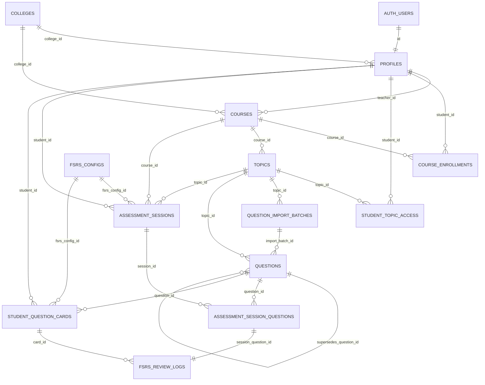

# Documentación de la base de datos

**Proyecto Supabase:** `oriol.palacios@acelera.io's Project`  
**Project ref:** `ueswxnnfklqqitjbpeha`  
**Región:** `ca-central-1`  
**PostgreSQL:** `17.6.1.147`  
**Estado:** `ACTIVE_HEALTHY`  
**Fecha de actualización:** 25 de julio de 2026

## Resumen general

La base de datos soporta una plataforma académica multiinstitución con tres roles: administrador, profesor y estudiante. Incluye gestión de colegios, usuarios, cursos, temas, asignaciones, bloqueos individuales, importación de preguntas, sesiones de evaluación y programación de repaso mediante FSRS.

Estado actual:

- 14 tablas en el esquema `public`.
- 7 vistas con `security_invoker = true`.
- 27 políticas RLS.
- 17 funciones auxiliares en `private`.
- 8 funciones de validación y triggers en `public`.
- 17 triggers.
- 50 índices.
- RLS activo en las 14 tablas.
- No existen Edge Functions desplegadas todavía.
- Las tablas se encuentran actualmente sin datos permanentes.

## Esquemas

- `auth`: administrado por Supabase Auth; contiene `auth.users`.
- `public`: tablas, vistas, enums y funciones de validación expuestas a la aplicación bajo RLS.
- `private`: funciones internas de autorización usadas como guards por RLS y por el backend.

## Tipos enumerados

| Tipo | Valores |
|---|---|
| `public.app_user_role` | `admin`, `teacher`, `student` |
| `public.course_status` | `active`, `inactive`, `archived` |
| `public.enrollment_status` | `active`, `inactive` |
| `public.topic_status` | `draft`, `active`, `inactive`, `archived` |
| `public.question_status` | `draft`, `active`, `inactive`, `archived` |
| `public.import_status` | `validating`, `completed`, `failed` |
| `public.session_status` | `in_progress`, `completed`, `abandoned` |
| `public.question_selection_reason` | `due`, `new` |
| `public.fsrs_rating` | `Again`, `Good` |

## Mapa general de relaciones



# Tablas

## public.colleges

Registra las instituciones educativas que participan en la plataforma.

**RLS:** activo.

| Columna | Tipo | Nulo | Valor por defecto | Descripción |
|---|---|---:|---|---|
| `id` | `uuid` | No | `gen_random_uuid()` | Identificador principal. |
| `code` | `text` | No | — | Código único del colegio. |
| `name` | `text` | No | — | Nombre de la institución. |
| `description` | `text` | Sí | — | Descripción opcional. |
| `is_active` | `boolean` | No | `true` | Indica si la institución está activa. |
| `created_at` | `timestamptz` | No | `now()` | Fecha de creación. |
| `updated_at` | `timestamptz` | No | `now()` | Última actualización. |

### Relaciones

- Es referenciada por `public.profiles.college_id`.
- Es referenciada por `public.courses.college_id`.
- Es referenciada por `public.audit_logs.college_id`.

### Constraints

- `colleges_pkey`: `PRIMARY KEY (id)`.
- `colleges_code_not_blank`: el código no puede estar vacío.
- `colleges_name_not_blank`: el nombre no puede estar vacío.
- Índice único `colleges_code_unique_ci`: evita códigos duplicados ignorando mayúsculas, minúsculas y espacios externos.

### Políticas RLS

- `colleges_select`: administrador puede ver todos; usuarios activos solo pueden ver su propio colegio.
- `colleges_insert`: solo administrador.
- `colleges_update`: solo administrador.

---

## public.profiles

Perfil de aplicación relacionado uno a uno con `auth.users`. Contiene rol, colegio, código visible y vigencia de acceso.

**RLS:** activo.

| Columna | Tipo | Nulo | Valor por defecto | Descripción |
|---|---|---:|---|---|
| `id` | `uuid` | No | — | PK y FK hacia `auth.users.id`. |
| `college_id` | `uuid` | Sí | — | Colegio al que pertenece el usuario. |
| `role` | `public.app_user_role` | No | — | `admin`, `teacher` o `student`. |
| `user_code` | `text` | No | — | Código visible y único de acceso. |
| `full_name` | `text` | No | — | Nombre completo. |
| `is_active` | `boolean` | No | `true` | Estado general del perfil. |
| `access_valid_from` | `date` | Sí | — | Inicio de vigencia del estudiante. |
| `access_valid_until` | `date` | Sí | — | Fin de vigencia del estudiante. |
| `created_by` | `uuid` | Sí | — | Administrador que creó el perfil. |
| `created_at` | `timestamptz` | No | `now()` | Fecha de creación. |
| `updated_at` | `timestamptz` | No | `now()` | Última actualización. |

### Relaciones

- `id → auth.users.id` con `ON DELETE CASCADE`.
- `college_id → public.colleges.id` con `ON DELETE CASCADE`.
- `created_by → public.profiles.id` con `ON DELETE CASCADE`.
- Es referenciada por cursos, inscripciones, bloqueos, importaciones, preguntas, sesiones, tarjetas FSRS, logs y auditoría.

### Constraints

- `profiles_pkey`: `PRIMARY KEY (id)`.
- `profiles_access_dates_order`: la fecha inicial no puede ser posterior a la final.
- `profiles_college_required`: profesores y estudiantes deben tener `college_id`; el administrador puede no tenerlo.
- `profiles_student_dates_required`: los estudiantes deben tener ambas fechas de vigencia.
- `profiles_full_name_not_blank`: nombre no vacío.
- `profiles_user_code_not_blank`: código no vacío.
- Índice único `profiles_user_code_unique_ci`: código único sin distinguir mayúsculas/minúsculas.

### Políticas RLS

- `profiles_select`: administrador ve todos; cada usuario ve su propio perfil; un profesor ve estudiantes inscritos en sus cursos.
- `profiles_update`: solo administrador.
- La creación se realizará mediante una Edge Function administrativa, no mediante acceso directo del frontend.

---

## public.courses

Cursos pertenecientes a un solo profesor y a un solo colegio.

**RLS:** activo.

| Columna | Tipo | Nulo | Valor por defecto | Descripción |
|---|---|---:|---|---|
| `id` | `uuid` | No | `gen_random_uuid()` | Identificador del curso. |
| `college_id` | `uuid` | No | — | Colegio del curso. |
| `teacher_id` | `uuid` | No | — | Profesor propietario. |
| `name` | `text` | No | — | Nombre del curso. |
| `description` | `text` | Sí | — | Descripción opcional. |
| `status` | `public.course_status` | No | `active` | Estado del curso. |
| `created_by` | `uuid` | Sí | — | Usuario creador. |
| `created_at` | `timestamptz` | No | `now()` | Fecha de creación. |
| `updated_at` | `timestamptz` | No | `now()` | Última actualización. |

### Relaciones

- `college_id → public.colleges.id` con `ON DELETE CASCADE`.
- `teacher_id → public.profiles.id` con `ON DELETE CASCADE`.
- `created_by → public.profiles.id` con `ON DELETE CASCADE`.
- Es referenciada por `course_enrollments`, `topics` y `assessment_sessions`.

### Constraints

- `courses_pkey`: `PRIMARY KEY (id)`.
- `courses_name_not_blank`: nombre no vacío.
- Trigger de negocio: máximo 8 cursos no archivados por profesor.
- Trigger de negocio: el propietario debe tener rol `teacher` y pertenecer al mismo colegio.
- Índice único parcial `courses_teacher_name_unique_active_ci`: un profesor no puede tener dos cursos no archivados con el mismo nombre, ignorando mayúsculas/minúsculas.

### Políticas RLS

- `courses_select`: administrador ve todos; profesor ve sus cursos; estudiante vigente ve los cursos donde está inscrito.
- `courses_insert`: administrador o profesor activo creando un curso propio en su colegio.
- `courses_update`: administrador o profesor propietario; no permite reasignar el curso a otro profesor/colegio fuera de sus permisos.

### Funciones relacionadas

`SECURITY INVOKER`, con `search_path = ''`. Las ejecuta un administrador autenticado desde la vista de cursos; si quien llama no es administrador fallan con `42501`. Los triggers y el índice único de arriba se siguen aplicando.

- `public.admin_move_course(p_course_id, p_teacher_id)`: pasa el curso a otro profesor (debe ser del mismo colegio y tener menos de 8 cursos). Como los estudiantes se asignan por profesor, reemplaza las matrículas del curso por las de los estudiantes del nuevo profesor. Si el curso ya es de ese profesor, no hace nada.
- `public.admin_duplicate_course(p_course_id)`: crea un curso para el mismo profesor y colegio con el nombre `<nombre> - duplicado`, y copia los temas y las preguntas no archivados (con su estado, sin `import_batch_id` ni `supersedes_question_id`). No copia sesiones, tarjetas FSRS ni accesos a temas, así que el curso empieza sin progreso. Los estudiantes del profesor se matriculan con el trigger `courses_sync_new_enrollments`. Devuelve el id del curso nuevo. Si el profesor ya tiene un curso con ese nombre, falla por `courses_teacher_name_unique_active_ci`.

---

## public.course_enrollments

Relaciona estudiantes con cursos. Un estudiante puede pertenecer a varios cursos de diferentes profesores dentro del mismo colegio.

**RLS:** activo.

| Columna | Tipo | Nulo | Valor por defecto | Descripción |
|---|---|---:|---|---|
| `id` | `uuid` | No | `gen_random_uuid()` | Identificador. |
| `course_id` | `uuid` | No | — | Curso asignado. |
| `student_id` | `uuid` | No | — | Estudiante asignado. |
| `status` | `public.enrollment_status` | No | `active` | Estado de inscripción. |
| `enrolled_by` | `uuid` | Sí | — | Usuario que realizó la asignación. |
| `enrolled_at` | `timestamptz` | No | `now()` | Fecha de inscripción. |
| `ended_at` | `timestamptz` | Sí | — | Fecha de término. |
| `created_at` | `timestamptz` | No | `now()` | Fecha de creación. |
| `updated_at` | `timestamptz` | No | `now()` | Última actualización. |

### Relaciones

- `course_id → public.courses.id` con `ON DELETE CASCADE`.
- `student_id → public.profiles.id` con `ON DELETE CASCADE`.
- `enrolled_by → public.profiles.id` con `ON DELETE CASCADE`.

### Constraints

- `course_enrollments_pkey`: `PRIMARY KEY (id)`.
- `course_enrollments_unique`: combinación única `(course_id, student_id)`.
- `course_enrollments_ended_consistency`: una inscripción activa debe tener `ended_at = NULL`.
- Trigger: el perfil debe ser estudiante y pertenecer al mismo colegio que el curso.
- Trigger: al pasar a `inactive`, establece `ended_at`; al reactivar, lo limpia.

### Políticas RLS

- `course_enrollments_select`: administrador, estudiante dueño de la inscripción o profesor propietario del curso.
- `course_enrollments_insert`: administrador o profesor autorizado para ese curso y estudiante.
- `course_enrollments_update`: administrador o profesor propietario del curso.
- `course_enrollments_delete`: únicamente el administrador puede eliminar matrículas; para bloqueos temporales se utiliza `status = inactive`.

### Eliminación de un profesor

La eliminación administrativa de un profesor comienza eliminando su cuenta de `auth.users`. La relación `profiles.id → auth.users.id` elimina su perfil y `courses.teacher_id → profiles.id` elimina en cascada todos los cursos que le pertenecen. A partir de esos cursos también se eliminan sus temas, preguntas, matrículas, sesiones, resultados, tarjetas FSRS, bloqueos y demás registros académicos dependientes.

Los perfiles de los estudiantes matriculados en esos cursos **no se eliminan**. La cascada elimina las filas de `course_enrollments` que apuntan a los cursos del profesor, pero no se propaga en sentido inverso desde una matrícula hacia el perfil del estudiante. El alumno conserva su cuenta y sus relaciones con otros profesores.

Existen dos campos de auditoría que actualmente usan `ON DELETE CASCADE` y deben considerarse:

- `profiles.created_by`: si un perfil tuviera al profesor eliminado como creador, ese perfil también sería eliminado. En el flujo administrativo actual los profesores y estudiantes son creados por un administrador, por lo que un estudiante no debería tener un profesor en este campo.
- `course_enrollments.enrolled_by`: eliminar un profesor también elimina cualquier matrícula registrada por él, incluso si excepcionalmente perteneciera a un curso de otro profesor.

Para garantizar estructuralmente que la eliminación se limite exclusivamente a los cursos propiedad del profesor, estos dos campos de auditoría deberían utilizar `ON DELETE SET NULL`. La cascada académica principal debe originarse en `courses.teacher_id`.

---

## public.topics

Temas o unidades dentro de un curso.

**RLS:** activo.

| Columna | Tipo | Nulo | Valor por defecto | Descripción |
|---|---|---:|---|---|
| `id` | `uuid` | No | `gen_random_uuid()` | Identificador. |
| `course_id` | `uuid` | No | — | Curso al que pertenece. |
| `name` | `text` | No | — | Nombre del tema. |
| `description` | `text` | Sí | — | Descripción opcional. |
| `material_url` | `text` | Sí | — | Enlace de material complementario. |
| `position` | `integer` | No | `1` | Orden del tema. |
| `status` | `public.topic_status` | No | `draft` | Estado del tema. |
| `created_by` | `uuid` | Sí | — | Usuario creador. |
| `created_at` | `timestamptz` | No | `now()` | Fecha de creación. |
| `updated_at` | `timestamptz` | No | `now()` | Última actualización. |

### Relaciones

- `course_id → public.courses.id` con `ON DELETE CASCADE`.
- `created_by → public.profiles.id` con `ON DELETE CASCADE`.
- Es referenciada por bloqueos, lotes de importación, preguntas y sesiones.

### Constraints

- `topics_pkey`: `PRIMARY KEY (id)`.
- `topics_name_not_blank`: nombre no vacío.
- `topics_position_positive`: posición mayor a cero.
- Trigger de negocio: máximo 25 temas no archivados por curso.
- Índice único parcial por `(course_id, position)` para temas no archivados.
- Índice único parcial por curso y nombre normalizado para temas no archivados.

### Políticas RLS

- `topics_select`: administrador, profesor propietario o estudiante vigente inscrito; el estudiante solo ve temas activos.
- `topics_insert`: administrador o profesor propietario del curso.
- `topics_update`: administrador o profesor propietario del curso.

---

## public.student_topic_access

Controla el bloqueo individual de un tema para un estudiante. El bloqueo no tiene fecha de expiración.

**RLS:** activo.

| Columna | Tipo | Nulo | Valor por defecto | Descripción |
|---|---|---:|---|---|
| `id` | `uuid` | No | `gen_random_uuid()` | Identificador. |
| `student_id` | `uuid` | No | — | Estudiante afectado. |
| `topic_id` | `uuid` | No | — | Tema bloqueado o habilitado. |
| `is_blocked` | `boolean` | No | `false` | Estado del bloqueo. |
| `updated_by` | `uuid` | Sí | — | Usuario que cambió el bloqueo. |
| `created_at` | `timestamptz` | No | `now()` | Fecha de creación. |
| `updated_at` | `timestamptz` | No | `now()` | Última actualización. |

### Relaciones

- `student_id → public.profiles.id` con `ON DELETE CASCADE`.
- `topic_id → public.topics.id` con `ON DELETE CASCADE`.
- `updated_by → public.profiles.id` con `ON DELETE CASCADE`.

### Constraints

- `student_topic_access_pkey`: `PRIMARY KEY (id)`.
- `student_topic_access_unique`: combinación única `(student_id, topic_id)`.
- Trigger: solo permite registrar bloqueo si el estudiante está activamente inscrito en el curso del tema.

### Políticas RLS

- `student_topic_access_select`: administrador, estudiante dueño o profesor autorizado.
- `student_topic_access_insert`: administrador o profesor autorizado, registrando su UUID en `updated_by`.
- `student_topic_access_update`: administrador o profesor autorizado.

---

## public.question_import_batches

Registra cada carga de preguntas desde Excel y su reporte de validación.

**RLS:** activo.

| Columna | Tipo | Nulo | Valor por defecto | Descripción |
|---|---|---:|---|---|
| `id` | `uuid` | No | `gen_random_uuid()` | Identificador del lote. |
| `topic_id` | `uuid` | No | — | Tema de destino. |
| `uploaded_by` | `uuid` | No | — | Profesor o administrador que cargó el archivo. |
| `filename` | `text` | No | — | Nombre original del archivo. |
| `total_rows` | `integer` | No | `0` | Filas analizadas. |
| `accepted_rows` | `integer` | No | `0` | Filas aceptadas. |
| `rejected_rows` | `integer` | No | `0` | Filas rechazadas. |
| `status` | `public.import_status` | No | `validating` | Estado de la importación. |
| `validation_report` | `jsonb` | No | `[]` | Errores y observaciones por fila. |
| `created_at` | `timestamptz` | No | `now()` | Inicio del proceso. |
| `completed_at` | `timestamptz` | Sí | — | Finalización del proceso. |

### Relaciones

- `topic_id → public.topics.id` con `ON DELETE CASCADE`.
- `uploaded_by → public.profiles.id` con `ON DELETE CASCADE`.
- Es referenciada por `public.questions.import_batch_id`.

### Constraints

- `question_import_batches_pkey`: `PRIMARY KEY (id)`.
- `question_import_filename_not_blank`: nombre de archivo no vacío.
- `question_import_counts_nonnegative`: todos los contadores deben ser no negativos.
- `question_import_counts_within_total`: aceptadas + rechazadas no puede exceder el total.

### Políticas RLS

- `question_import_batches_select`: administrador o profesor propietario del tema.
- `question_import_batches_insert`: administrador o profesor propietario; `uploaded_by` debe coincidir con el usuario autenticado para el caso del profesor.

---

## public.questions

Banco de preguntas de cuatro alternativas, compatible con texto LaTeX y explicación opcional.

**RLS:** activo. Los estudiantes no tienen acceso directo a esta tabla porque contiene `correct_option` y `explanation`.

| Columna | Tipo | Nulo | Valor por defecto | Descripción |
|---|---|---:|---|---|
| `id` | `uuid` | No | `gen_random_uuid()` | Identificador. |
| `topic_id` | `uuid` | No | — | Tema de la pregunta. |
| `import_batch_id` | `uuid` | Sí | — | Lote Excel de origen. |
| `statement` | `text` | No | — | Enunciado. |
| `option_a` | `text` | No | — | Alternativa A. |
| `option_b` | `text` | No | — | Alternativa B. |
| `option_c` | `text` | No | — | Alternativa C. |
| `option_d` | `text` | No | — | Alternativa D. |
| `correct_option` | `char` | No | — | `A`, `B`, `C` o `D`. |
| `explanation` | `text` | Sí | — | Explicación mostrada después de completar la sesión. |
| `status` | `public.question_status` | No | `active` | Estado de la pregunta. |
| `supersedes_question_id` | `uuid` | Sí | — | Pregunta anterior reemplazada por esta versión. |
| `created_by` | `uuid` | No | — | Usuario creador. |
| `created_at` | `timestamptz` | No | `now()` | Fecha de creación. |
| `updated_at` | `timestamptz` | No | `now()` | Última actualización. |

### Relaciones

- `topic_id → public.topics.id` con `ON DELETE CASCADE`.
- `import_batch_id → public.question_import_batches.id` con `ON DELETE SET NULL`.
- `supersedes_question_id → public.questions.id` con `ON DELETE SET NULL`.
- `created_by → public.profiles.id` con `ON DELETE CASCADE`.
- Es referenciada por preguntas de sesión, tarjetas FSRS y logs FSRS.

### Constraints

- `questions_pkey`: `PRIMARY KEY (id)`.
- Enunciado y cuatro alternativas no pueden estar vacíos.
- `questions_correct_option_valid`: la respuesta correcta debe ser `A`, `B`, `C` o `D`.
- `questions_not_self_superseding`: una pregunta no puede reemplazarse a sí misma.
- Trigger de negocio: máximo 50 preguntas no archivadas por tema.

### Políticas RLS

- `questions_select`: solo administrador o profesor propietario del tema.
- `questions_insert`: administrador o profesor propietario del tema.
- No hay política directa para estudiantes.
- Las actualizaciones deben seguir el mecanismo de versionado y ejecutarse desde el backend.

---

## public.fsrs_configs

Versiona la configuración utilizada por la librería `ts-fsrs`.

**RLS:** activo.

| Columna | Tipo | Nulo | Valor por defecto | Descripción |
|---|---|---:|---|---|
| `id` | `uuid` | No | `gen_random_uuid()` | Identificador de configuración. |
| `name` | `text` | No | — | Nombre de versión. |
| `library_name` | `text` | No | `ts-fsrs` | Librería utilizada. |
| `library_version` | `text` | No | — | Versión de la librería. |
| `parameters` | `jsonb` | No | `{}` | Parámetros FSRS. |
| `rating_mapping` | `jsonb` | No | `{"correct":"Good","incorrect":"Again"}` | Mapeo de resultado a rating. |
| `is_active` | `boolean` | No | `false` | Configuración activa. |
| `locked_at` | `timestamptz` | Sí | — | Momento en que quedó fijada. |
| `created_at` | `timestamptz` | No | `now()` | Fecha de creación. |

### Relaciones

- Es referenciada por `assessment_sessions.fsrs_config_id`.
- Es referenciada por `student_question_cards.fsrs_config_id`.
- Es referenciada por `fsrs_review_logs.fsrs_config_id`.

### Constraints

- `fsrs_configs_pkey`: `PRIMARY KEY (id)`.
- Nombre y versión no pueden estar vacíos.
- Índice único parcial `fsrs_configs_single_active_idx`: solo puede existir una configuración activa.

### Configuración activa

- `FSRS v6 pasos diarios, máximo 45 días` (migración `20261120130000`): `learning_steps ["12h","1d"]`, `relearning_steps ["1d"]` y `maximum_interval 44`.
- Primer acierto de una pregunta nueva: vuelve a 1 día. Primer fallo: 12 h. Fallo de una pregunta ya aprendida: 1 día.
- El tope real es 45 días: `ts-fsrs` suma 1 día después de aplicar `maximum_interval`, por eso el parámetro es 44.
- `request_retention` queda en el valor por defecto (0.90). Cambiar la configuración se hace creando una fila nueva y activándola, nunca editando la anterior.

### Políticas RLS

- `fsrs_configs_select`: cualquier usuario autenticado y activo puede leer la configuración.
- La escritura queda reservada para backend o administración.

---

## public.assessment_sessions

Representa una sesión de evaluación de un estudiante sobre un único tema, con entre 1 y 20 preguntas.

**RLS:** activo.

| Columna | Tipo | Nulo | Valor por defecto | Descripción |
|---|---|---:|---|---|
| `id` | `uuid` | No | `gen_random_uuid()` | Identificador de sesión. |
| `student_id` | `uuid` | No | — | Estudiante propietario. |
| `course_id` | `uuid` | No | — | Curso evaluado. |
| `topic_id` | `uuid` | No | — | Tema evaluado. |
| `fsrs_config_id` | `uuid` | No | — | Configuración FSRS usada. |
| `status` | `public.session_status` | No | `in_progress` | Estado de la sesión. |
| `started_at` | `timestamptz` | No | `now()` | Inicio. |
| `completed_at` | `timestamptz` | Sí | — | Finalización correcta. |
| `abandoned_at` | `timestamptz` | Sí | — | Abandono. |
| `total_questions` | `integer` | No | — | Total entre 1 y 20. |
| `answered_questions` | `integer` | No | `0` | Preguntas respondidas. |
| `correct_count` | `integer` | No | `0` | Respuestas correctas. |
| `incorrect_count` | `integer` | No | `0` | Respuestas incorrectas. |
| `created_at` | `timestamptz` | No | `now()` | Fecha de creación. |
| `updated_at` | `timestamptz` | No | `now()` | Última actualización. |

### Relaciones

- `student_id → public.profiles.id` con `ON DELETE CASCADE`.
- `course_id → public.courses.id` con `ON DELETE CASCADE`.
- `topic_id → public.topics.id` con `ON DELETE CASCADE`.
- `fsrs_config_id → public.fsrs_configs.id` con `ON DELETE RESTRICT`.
- Es referenciada por `assessment_session_questions` con borrado en cascada.

### Constraints

- `assessment_sessions_pkey`: `PRIMARY KEY (id)`.
- `assessment_sessions_total_range`: entre 1 y 20 preguntas.
- Contadores no negativos.
- `correct_count + incorrect_count = answered_questions`.
- `answered_questions <= total_questions`.
- Coherencia entre estado y fechas: completada requiere `completed_at`; abandonada requiere `abandoned_at`; en progreso no tiene ninguna.
- Trigger: el tema debe pertenecer al curso.
- Trigger: el propietario debe ser estudiante activamente inscrito en el curso.

### Políticas RLS

- `assessment_sessions_select`: administrador; profesor propietario del curso; estudiante dueño con acceso vigente.
- No existen políticas de escritura directa. La creación, respuesta y finalización deben ejecutarse desde Edge Functions.

---

## public.assessment_session_questions

Contiene las preguntas seleccionadas para una sesión y la respuesta del estudiante.

**RLS:** activo.

| Columna | Tipo | Nulo | Valor por defecto | Descripción |
|---|---|---:|---|---|
| `id` | `uuid` | No | `gen_random_uuid()` | Identificador. |
| `session_id` | `uuid` | No | — | Sesión. |
| `question_id` | `uuid` | No | — | Pregunta seleccionada. |
| `position` | `integer` | No | — | Orden dentro de la sesión. |
| `selection_reason` | `public.question_selection_reason` | No | — | `due` o `new`. |
| `due_at_snapshot` | `timestamptz` | Sí | — | Fecha de vencimiento al seleccionar la pregunta. |
| `selected_option` | `char` | Sí | — | Alternativa respondida. |
| `is_correct` | `boolean` | Sí | — | Resultado calculado. |
| `fsrs_rating` | `public.fsrs_rating` | Sí | — | `Again` o `Good`. |
| `answered_at` | `timestamptz` | Sí | — | Fecha de respuesta. |
| `response_time_ms` | `integer` | Sí | — | Tiempo de respuesta. |
| `created_at` | `timestamptz` | No | `now()` | Fecha de creación. |
| `updated_at` | `timestamptz` | No | `now()` | Última actualización. |

### Relaciones

- `session_id → public.assessment_sessions.id` con `ON DELETE CASCADE`.
- `question_id → public.questions.id` con `ON DELETE CASCADE`.
- Es referenciada por `fsrs_review_logs.session_question_id`.

### Constraints

- `assessment_session_questions_pkey`: `PRIMARY KEY (id)`.
- Combinación única `(session_id, position)`.
- Combinación única `(session_id, question_id)`.
- Posición mayor a cero.
- Tiempo de respuesta no negativo.
- Alternativa nula o `A`, `B`, `C`, `D`.
- Consistencia de respuesta: opción, resultado, rating y fecha deben estar todos nulos o todos completos.
- Trigger: la pregunta debe pertenecer al mismo tema que la sesión.

### Políticas RLS

- `assessment_session_questions_select`: administrador; profesor propietario; estudiante dueño de la sesión con acceso vigente.
- No existe escritura directa para usuarios finales.

---

## public.student_question_cards

Mantiene el estado FSRS actual de cada par estudiante–pregunta.

**RLS:** activo.

| Columna | Tipo | Nulo | Valor por defecto | Descripción |
|---|---|---:|---|---|
| `id` | `uuid` | No | `gen_random_uuid()` | Identificador. |
| `student_id` | `uuid` | No | — | Estudiante. |
| `question_id` | `uuid` | No | — | Pregunta. |
| `fsrs_config_id` | `uuid` | No | — | Configuración FSRS. |
| `due_at` | `timestamptz` | No | — | Próxima fecha de repaso. |
| `stability` | `numeric` | Sí | — | Estabilidad FSRS. |
| `difficulty` | `numeric` | Sí | — | Dificultad FSRS. |
| `elapsed_days` | `integer` | No | `0` | Días transcurridos. |
| `scheduled_days` | `integer` | No | `0` | Días programados. |
| `learning_steps` | `integer` | No | `0` | Pasos de aprendizaje. |
| `reps` | `integer` | No | `0` | Número de repasos. |
| `lapses` | `integer` | No | `0` | Fallos acumulados. |
| `state` | `smallint` | No | `0` | Estado FSRS de 0 a 3. |
| `last_review_at` | `timestamptz` | Sí | — | Último repaso. |
| `fsrs_data` | `jsonb` | No | `{}` | Estado completo serializado. |
| `created_at` | `timestamptz` | No | `now()` | Fecha de creación. |
| `updated_at` | `timestamptz` | No | `now()` | Última actualización. |

### Relaciones

- `student_id → public.profiles.id` con `ON DELETE CASCADE`.
- `question_id → public.questions.id` con `ON DELETE CASCADE`.
- `fsrs_config_id → public.fsrs_configs.id` con `ON DELETE RESTRICT`.
- Es referenciada por `fsrs_review_logs.card_id`.

### Constraints

- `student_question_cards_pkey`: `PRIMARY KEY (id)`.
- `student_question_cards_unique`: combinación única `(student_id, question_id)`.
- Contadores FSRS no negativos.
- `state` entre 0 y 3.

### Políticas RLS

- `student_question_cards_select`: administrador o estudiante propietario.
- Las mutaciones quedan reservadas al backend después de evaluar una respuesta.

---

## public.fsrs_review_logs

Historial inmutable de cada transición de programación FSRS.

**RLS:** activo.

| Columna | Tipo | Nulo | Descripción |
|---|---|---:|---|
| `id` | `uuid` | No | Identificador. |
| `card_id` | `uuid` | No | Tarjeta FSRS afectada. |
| `session_question_id` | `uuid` | No | Respuesta que produjo el cambio. |
| `student_id` | `uuid` | No | Estudiante. |
| `question_id` | `uuid` | No | Pregunta. |
| `fsrs_config_id` | `uuid` | No | Configuración utilizada. |
| `rating` | `public.fsrs_rating` | No | `Again` o `Good`. |
| `reviewed_at` | `timestamptz` | No | Fecha del repaso. |
| `due_before` / `due_after` | `timestamptz` | Variable | Vencimiento previo y nuevo. |
| `stability_before` / `stability_after` | `numeric` | Variable | Estabilidad antes y después. |
| `difficulty_before` / `difficulty_after` | `numeric` | Variable | Dificultad antes y después. |
| `state_before` / `state_after` | `smallint` | Variable | Estado antes y después. |
| `scheduled_days_before` / `scheduled_days_after` | `integer` | Variable | Intervalo antes y después. |
| `created_at` | `timestamptz` | No | Fecha de creación. |

### Relaciones

- `card_id → public.student_question_cards.id` con `ON DELETE CASCADE`.
- `session_question_id → public.assessment_session_questions.id` con `ON DELETE CASCADE`.
- `student_id → public.profiles.id` con `ON DELETE CASCADE`.
- `question_id → public.questions.id` con `ON DELETE CASCADE`.
- `fsrs_config_id → public.fsrs_configs.id` con `ON DELETE RESTRICT`.

### Constraints

- `fsrs_review_logs_pkey`: `PRIMARY KEY (id)`.
- `session_question_id` único: una respuesta solo puede generar una transición FSRS.
- Estados antes/después entre 0 y 3.
- Días programados no negativos.

### Políticas RLS

- `fsrs_review_logs_select`: solo administrador.
- La escritura se realiza únicamente desde el backend.

---

## public.audit_logs

Bitácora de acciones administrativas y de profesores.

**RLS:** activo.

| Columna | Tipo | Nulo | Valor por defecto | Descripción |
|---|---|---:|---|---|
| `id` | `uuid` | No | `gen_random_uuid()` | Identificador. |
| `actor_user_id` | `uuid` | Sí | — | Usuario que ejecutó la acción. |
| `college_id` | `uuid` | Sí | — | Colegio relacionado. |
| `action` | `text` | No | — | Nombre de la acción. |
| `entity_type` | `text` | No | — | Tipo de entidad afectada. |
| `entity_id` | `uuid` | Sí | — | ID de la entidad. |
| `metadata` | `jsonb` | No | `{}` | Información adicional. |
| `created_at` | `timestamptz` | No | `now()` | Fecha de la acción. |

### Relaciones

- `actor_user_id → public.profiles.id` con `ON DELETE CASCADE`.
- `college_id → public.colleges.id` con `ON DELETE CASCADE`.
- `entity_id` es polimórfico y no tiene FK fija.

### Constraints

- `audit_logs_pkey`: `PRIMARY KEY (id)`.
- `action` no puede estar vacío.
- `entity_type` no puede estar vacío.

### Políticas RLS

- `audit_logs_select`: solo administrador.
- La inserción se realizará desde Edge Functions o procesos internos.

---

## public.student_invitations

Invitaciones de estudiantes enviadas por un administrador. El administrador fija el correo, el periodo de acceso y, opcionalmente, el grupo (profesor); el estudiante recibe un link para completar sus datos y crear su cuenta, sin verificar el correo ni pagar. Del link solo se guarda el hash SHA-256 del código. La fila se borra al aceptarse o anularse, y las vencidas se conservan 30 días para poder reenviarlas.

Migraciones: `20261013120000_student_invitations.sql` y `20261025120000_invitation_group_selection.sql`.

**RLS:** activo, sin políticas. Solo se accede desde Edge Functions con `service_role` (`invitations` y `student-invitation`).

| Columna | Tipo | Nulo | Valor por defecto | Descripción |
|---|---|---:|---|---|
| `id` | `uuid` | No | `gen_random_uuid()` | Identificador. |
| `email` | `text` | No | — | Correo del estudiante invitado. |
| `teacher_id` | `uuid` | Sí | — | Grupo fijado por el administrador. Si es nulo, el estudiante elige su grupo al aceptar. |
| `college_id` | `uuid` | Sí | — | Institución del grupo fijado. En invitaciones antiguas (sin grupo) limita los grupos que puede elegir el estudiante a los de esa institución. |
| `access_valid_from` | `date` | No | — | Inicio del acceso del estudiante. |
| `access_valid_until` | `date` | No | — | Fin del acceso del estudiante. |
| `code_hash` | `text` | No | — | Hash SHA-256 del código del link. |
| `expires_at` | `timestamptz` | No | — | Vencimiento del link (7 días, nunca después del último día de acceso). |
| `invited_by` | `uuid` | Sí | — | Administrador que invitó. |
| `created_at` | `timestamptz` | No | `now()` | Fecha de creación. |

### Relaciones

- `teacher_id → public.profiles.id` con `ON DELETE SET NULL`.
- `college_id → public.colleges.id` con `ON DELETE CASCADE`.
- `invited_by → public.profiles.id` con `ON DELETE SET NULL`.

### Constraints

- `student_invitations_pkey`: `PRIMARY KEY (id)`.
- `student_invitations_email_not_blank`: `email` no puede estar vacío.
- `student_invitations_dates_ordered`: `access_valid_from <= access_valid_until`.
- `student_invitations_teacher_requires_college`: si hay `teacher_id`, debe haber `college_id`.
- `student_invitations_email_unique_ci`: una invitación por correo (sin distinguir mayúsculas); invitar de nuevo reemplaza la anterior.
- `student_invitations_code_hash_unique`: el hash del código es único.

### Tareas programadas

- `purge-expired-student-invitations` (pg_cron, cada hora): borra las invitaciones vencidas hace más de 30 días.

### Funciones relacionadas

Ambas son `SECURITY DEFINER`, con `search_path = ''`, y solo las ejecuta `service_role`.

- `public.edge_registration_teachers()`: grupos que puede elegir un estudiante, tanto en el autoservicio como en la invitación. Devuelve `teacher_id`, `teacher_name`, `college_id` y `college_name` de los profesores activos, de un colegio activo, con al menos un curso no archivado.
- `public.edge_accept_student_invitation(...)`: acepta una invitación en una sola transacción. Valida el grupo (el fijado por el administrador o, si no hay, el elegido por el estudiante entre los de `edge_registration_teachers()`), toma de él la institución, borra la invitación, crea el perfil del estudiante con el periodo de acceso de la invitación, lo matricula en los cursos no archivados del profesor y registra `invitation.accepted` en `audit_logs`. Si algo falla, todo vuelve atrás y la invitación no se pierde. Errores: `invalid_invitation`, `teacher_required`, `invalid_teacher`.

## public.plan_payments

Pagos de los planes de estudiante, para el registro y la renovación. Desde el
26/10/2026 se cobran con Yape a través de Mercado Pago; las filas anteriores son
cobros de Kuti y se conservan como historial. El monto lo fija el servidor según
el plan. Las Edge Functions crean y aplican los pagos con `service_role`.

**RLS:** activo.

| Columna | Tipo | Nulo | Valor por defecto | Descripción |
|---|---|---:|---|---|
| `id` | `uuid` | No | — | Identificador; viaja a Mercado Pago como `external_reference` y llave de idempotencia. |
| `provider` | `text` | No | `'mercadopago'` | `mercadopago` o `kuti` (historial). |
| `provider_payment_id` | `text` | Sí | — | Id de la orden de Mercado Pago (`ORD…`) o del cobro de Kuti; llega después de crear la fila. |
| `livemode` | `boolean` | No | — | `false` si es un pago de prueba. |
| `plan` | `text` | No | — | `mensual` o `semestral`. |
| `amount` | `numeric(10,2)` | No | — | Monto cobrado, en soles. |
| `registration_id` | `uuid` | Sí | — | Registro que se activa con el pago. |
| `profile_id` | `uuid` | Sí | — | Estudiante que renueva o cuya cuenta se creó con el pago. |
| `email` | `text` | Sí | — | Correo de quien pagó, para ubicar el pago si se borra el dueño. |
| `status` | `text` | No | `'pending'` | `pending`, `succeeded`, `failed`, `expired` (solo Kuti) o `cancelled`. |
| `status_detail` | `text` | Sí | — | Motivo que da Mercado Pago, por ejemplo al rechazar. |
| `paid_at` | `timestamptz` | Sí | — | Cuándo se aprobó. |
| `applied_at` | `timestamptz` | Sí | — | Cuándo se aplicó (cuenta creada o plan extendido). |
| `period_start`, `period_end` | `date` | Sí | — | Días de acceso que cubrió el pago. |
| `resolved_at` | `timestamptz` | Sí | — | El administrador marcó como resuelto un pago que no se pudo aplicar. |
| `created_at` | `timestamptz` | No | `now()` | Fecha de creación. |

### Constraints

- `plan_payments_provider_payment_id_unique`: `UNIQUE (provider, provider_payment_id)`.
- `plan_payments_paid_complete`: `status = 'succeeded'` si y solo si hay `paid_at`.
- `plan_payments_applied_complete` y `plan_payments_applied_paid`: un pago aplicado tiene su periodo y está pagado.

### Políticas RLS

- `plan_payments_admin_select`: solo el administrador consulta los pagos.
- `plan_payments_admin_resolve`: solo el administrador actualiza `resolved_at`.

### Secreto del webhook

`edge_mercadopago_webhook_secret()` (solo `service_role`) lee de Vault el
secreto `mercadopago_webhook_secret`, con el que Mercado Pago firma sus avisos.
Se guarda desde el editor SQL:

```sql
select vault.create_secret('<clave secreta del panel>', 'mercadopago_webhook_secret');
-- Para cambiarla (por ejemplo, al pasar a producción):
select vault.update_secret(id, '<nueva clave>') from vault.secrets where name = 'mercadopago_webhook_secret';
```

---

# Funciones

Las funciones de `private` son guards de autorización. Todas son `SECURITY DEFINER`, tienen `search_path = ''`, no son ejecutables por `PUBLIC` y están autorizadas para el rol PostgreSQL `authenticated`.

## Funciones de autorización

### private.current_role

- **Parámetros:** ninguno.
- **Retorna:** `text`.
- Obtiene el rol de aplicación del usuario autenticado desde `public.profiles`.

### private.current_college_id

- **Parámetros:** ninguno.
- **Retorna:** `uuid`.
- Obtiene el colegio asignado al usuario autenticado.

### private.is_active_user

- **Parámetros:** ninguno.
- **Retorna:** `boolean`.
- Comprueba que el perfil autenticado exista y esté marcado como activo.

### private.is_admin

- **Parámetros:** ninguno.
- **Retorna:** `boolean`.
- Comprueba que el usuario autenticado sea administrador y esté activo.

### private.is_teacher

- **Parámetros:** ninguno.
- **Retorna:** `boolean`.
- Comprueba que el perfil autenticado tenga el rol `teacher`.

### private.is_student

- **Parámetros:** ninguno.
- **Retorna:** `boolean`.
- Comprueba que el usuario autenticado sea estudiante y esté activo.

### private.has_valid_student_access

- **Parámetros:** ninguno.
- **Retorna:** `boolean`.
- Comprueba que el usuario sea estudiante activo y que la fecha actual de Lima esté dentro de su periodo de vigencia.

### private.can_access_college

- **Parámetros:** `target_college_id uuid`.
- **Retorna:** `boolean`.
- Permite acceso si el usuario es administrador o pertenece activamente al colegio indicado.

### private.teacher_owns_course

- **Parámetros:** `target_course_id uuid`.
- **Retorna:** `boolean`.
- Comprueba que el usuario sea el profesor propietario de un curso no archivado.

### private.teacher_owns_topic

- **Parámetros:** `target_topic_id uuid`.
- **Retorna:** `boolean`.
- Comprueba que el usuario sea propietario del curso al que pertenece el tema.

### private.student_is_enrolled

- **Parámetros:** `target_course_id uuid`.
- **Retorna:** `boolean`.
- Comprueba que el estudiante autenticado tenga una inscripción activa en el curso.

### private.student_can_access_topic

- **Parámetros:** `target_topic_id uuid`.
- **Retorna:** `boolean`.
- Comprueba vigencia, inscripción, estados activos y ausencia de bloqueo individual antes de iniciar un tema.

### private.teacher_can_manage_enrollment

- **Parámetros:** `target_course_id uuid`, `target_student_id uuid`.
- **Retorna:** `boolean`.
- Comprueba que el profesor sea dueño del curso y que el estudiante activo pertenezca al mismo colegio.

### private.teacher_can_manage_topic_access

- **Parámetros:** `target_topic_id uuid`, `target_student_id uuid`.
- **Retorna:** `boolean`.
- Comprueba que el profesor sea dueño del tema y que el estudiante esté activamente inscrito en el curso.

### private.student_owns_session

- **Parámetros:** `target_session_id uuid`.
- **Retorna:** `boolean`.
- Comprueba que una sesión pertenezca al estudiante autenticado.

### private.teacher_can_view_session

- **Parámetros:** `target_session_id uuid`.
- **Retorna:** `boolean`.
- Comprueba que la sesión corresponda a un curso propiedad del profesor autenticado.

### private.teacher_can_view_student

- **Parámetros:** `target_student_id uuid`.
- **Retorna:** `boolean`.
- Comprueba que el estudiante esté inscrito activamente en al menos un curso del profesor.

## Funciones de validación y triggers

### public.set_updated_at

- **Parámetros:** ninguno; función de trigger.
- **Retorna:** `trigger`.
- Actualiza automáticamente `updated_at` antes de modificar una fila.

### public.validate_course_teacher_and_limit

- **Parámetros:** ninguno; usa `NEW`.
- **Retorna:** `trigger`.
- Valida rol/colegio del profesor y el máximo de 8 cursos no archivados.

### public.validate_topic_limit

- **Parámetros:** ninguno; usa `NEW`.
- **Retorna:** `trigger`.
- Impide superar 25 temas no archivados dentro de un curso.

### public.validate_question_limit

- **Parámetros:** ninguno; usa `NEW`.
- **Retorna:** `trigger`.
- Impide superar 50 preguntas no archivadas dentro de un tema.

### public.validate_course_enrollment

- **Parámetros:** ninguno; usa `NEW`.
- **Retorna:** `trigger`.
- Valida que el perfil sea estudiante, pertenezca al colegio del curso y mantiene `ended_at` coherente.

### public.validate_student_topic_access

- **Parámetros:** ninguno; usa `NEW`.
- **Retorna:** `trigger`.
- Solo permite bloquear o habilitar temas de estudiantes inscritos activamente en el curso.

### public.validate_assessment_session

- **Parámetros:** ninguno; usa `NEW`.
- **Retorna:** `trigger`.
- Valida correspondencia curso–tema, rol de estudiante e inscripción activa.

### public.validate_session_question

- **Parámetros:** ninguno; usa `NEW`.
- **Retorna:** `trigger`.
- Verifica que cada pregunta agregada a una sesión pertenezca al tema evaluado.

# Triggers

| Tabla | Trigger | Evento | Función |
|---|---|---|---|
| `colleges` | `colleges_set_updated_at` | BEFORE UPDATE | `set_updated_at()` |
| `profiles` | `profiles_set_updated_at` | BEFORE UPDATE | `set_updated_at()` |
| `courses` | `courses_set_updated_at` | BEFORE UPDATE | `set_updated_at()` |
| `courses` | `courses_validate_teacher_and_limit` | BEFORE INSERT/UPDATE | `validate_course_teacher_and_limit()` |
| `course_enrollments` | `course_enrollments_set_updated_at` | BEFORE UPDATE | `set_updated_at()` |
| `course_enrollments` | `course_enrollments_validate` | BEFORE INSERT/UPDATE | `validate_course_enrollment()` |
| `topics` | `topics_set_updated_at` | BEFORE UPDATE | `set_updated_at()` |
| `topics` | `topics_validate_limit` | BEFORE INSERT/UPDATE | `validate_topic_limit()` |
| `student_topic_access` | `student_topic_access_set_updated_at` | BEFORE UPDATE | `set_updated_at()` |
| `student_topic_access` | `student_topic_access_validate` | BEFORE INSERT/UPDATE | `validate_student_topic_access()` |
| `questions` | `questions_set_updated_at` | BEFORE UPDATE | `set_updated_at()` |
| `questions` | `questions_validate_limit` | BEFORE INSERT/UPDATE | `validate_question_limit()` |
| `assessment_sessions` | `assessment_sessions_set_updated_at` | BEFORE UPDATE | `set_updated_at()` |
| `assessment_sessions` | `assessment_sessions_validate` | BEFORE INSERT/UPDATE | `validate_assessment_session()` |
| `assessment_session_questions` | `assessment_session_questions_set_updated_at` | BEFORE UPDATE | `set_updated_at()` |
| `assessment_session_questions` | `assessment_session_questions_validate` | BEFORE INSERT/UPDATE | `validate_session_question()` |
| `student_question_cards` | `student_question_cards_set_updated_at` | BEFORE UPDATE | `set_updated_at()` |

# Vistas

Todas las vistas tienen `security_invoker = true`; por tanto, respetan las políticas RLS de las tablas subyacentes.

## public.v_session_results

- Resume cada sesión con estudiante, curso, tema, estado, cantidad de respuestas, correctas, incorrectas y porcentajes.
- Sirve para listados rápidos de resultados sin consultar manualmente varias tablas.

## public.v_student_topic_progress

- Agrupa sesiones completadas por estudiante, curso y tema.
- Calcula sesiones completadas, preguntas respondidas, aciertos, errores, porcentajes y última fecha de actividad.

## public.v_student_course_progress

- Agrupa la vista de progreso por tema a nivel de curso.
- Muestra cantidad de temas con datos, sesiones, respuestas y promedios de acierto/error del estudiante.

## public.v_teacher_students

- Relaciona cada profesor con sus cursos y estudiantes inscritos.
- Incluye estado del estudiante, vigencia, estado de inscripción y última sesión completada.

## public.v_student_topic_access_status

- Genera el listado de temas disponibles para cada inscripción activa.
- Combina el bloqueo individual y devuelve `is_blocked = false` cuando no existe una fila explícita de bloqueo.

## public.v_completed_session_review

- Presenta el detalle de una sesión completada: enunciado, alternativas, respuesta elegida, respuesta correcta, resultado, explicación y rating FSRS.
- Es una vista sensible porque revela `correct_option` y `explanation`.
- El permiso directo para `authenticated` está revocado; debe exponerse mediante una Edge Function después de validar sesión completada y propiedad.

## public.v_export_all_data

- Une colegio, profesor, estudiante, curso, tema, sesiones, preguntas, respuestas, tarjetas FSRS y logs de transición.
- Está diseñada para generar la exportación completa en CSV.
- El permiso directo para `authenticated` está revocado; debe utilizarse desde backend autorizado.

# Seguridad RLS

Principios implementados:

- El administrador puede gestionar información global.
- El profesor solo puede gestionar cursos, temas, estudiantes y preguntas relacionados con sus propios cursos.
- El estudiante solo puede ver información propia y contenido de cursos donde está inscrito.
- El estudiante vencido no puede ver cursos, sesiones ni preguntas de sesión.
- Un tema bloqueado impide iniciar una sesión mediante `private.student_can_access_topic`.
- El estudiante nunca consulta directamente `public.questions`.
- Las escrituras sensibles de sesiones, respuestas, tarjetas FSRS, logs y auditoría quedan reservadas al backend.
- `service_role` debe usarse solamente dentro de Edge Functions y nunca en el frontend.

Pruebas realizadas:

- Casos de administrador, profesor y estudiante.
- Aislamiento entre colegios y profesores.
- Bloqueo de lectura de preguntas para estudiantes.
- Restricción de modificaciones sobre recursos ajenos.
- Bloqueo de estudiantes vencidos.
- Retest específico de las tres políticas corregidas: 12 de 12 casos aprobados.

# Índices principales

- Unicidad de códigos de colegio y usuario sin distinguir mayúsculas/minúsculas.
- Índices por profesor/estado en cursos.
- Índices por curso/estado/posición en temas.
- Índices por curso y estudiante en inscripciones.
- Índices por estudiante/tema/bloqueo.
- Índices por tema/estado y lote de importación en preguntas.
- Índices por estudiante/tema/fecha en sesiones.
- Índices por sesión/posición y pregunta en preguntas de sesión.
- Índices por estudiante/fecha de vencimiento en tarjetas FSRS.
- Índices históricos por estudiante, pregunta y tarjeta en logs FSRS.
- Índices por actor, colegio y entidad en auditoría.

# Migraciones registradas

| Versión | Nombre |
|---|---|
| `20260724043042` | `create_learning_platform_core_schema` |
| `20260724043120` | `create_learning_platform_views` |

# Estado de los Advisors

## Security Advisor

Actualmente reporta ocho advertencias `function_search_path_mutable` sobre las funciones públicas de trigger:

- `public.set_updated_at`
- `public.validate_course_teacher_and_limit`
- `public.validate_topic_limit`
- `public.validate_question_limit`
- `public.validate_course_enrollment`
- `public.validate_student_topic_access`
- `public.validate_assessment_session`
- `public.validate_session_question`

Estas funciones deben fijar explícitamente un `search_path` seguro.

## Performance Advisor

Reporta 11 claves foráneas sin un índice dedicado:

- `assessment_sessions.fsrs_config_id`
- `course_enrollments.enrolled_by`
- `courses.created_by`
- `fsrs_review_logs.fsrs_config_id`
- `profiles.created_by`
- `question_import_batches.uploaded_by`
- `questions.created_by`
- `student_question_cards.fsrs_config_id`
- `student_topic_access.topic_id`
- `student_topic_access.updated_by`
- `topics.created_by`

También aparecen varios índices como no utilizados porque la base de datos todavía no contiene actividad real. No deben eliminarse hasta evaluar consultas y métricas con datos representativos.

# Observaciones técnicas actuales

1. `private.has_valid_student_access()` repite actualmente la comprobación `access_valid_from IS NOT NULL`; la restricción de `profiles` obliga ambas fechas para estudiantes, pero conviene cambiar la segunda comprobación a `access_valid_until IS NOT NULL` para que el código sea explícito.
2. `private.is_teacher()` verifica el rol, pero su definición actual no comprueba `is_active`; conviene añadir esa validación para mantener consistencia con `is_admin()` e `is_student()`.
3. `private.teacher_owns_course()` excluye cursos archivados. Esto significa que el profesor no podrá consultarlos mediante esta función; debe confirmarse si el archivo debe seguir siendo visible en modo lectura.
4. No existen todavía Edge Functions desplegadas. Las operaciones administrativas y académicas sensibles siguen pendientes de implementación.
5. Las vistas sensibles están correctamente revocadas para acceso directo del rol `authenticated`.

## public.student_progress_purges

Progreso de un estudiante en un curso que dejó cuando el administrador le cambió
el grupo. Se conserva 7 días y luego se borra, salvo que el estudiante vuelva a
estar activo en ese curso (por ejemplo, si lo regresan a su grupo o lo inscriben
desde Asignaciones).

**RLS:** activo, sin políticas. Solo se accede desde Edge Functions con `service_role` (`admin-student-account`) y desde el job de limpieza.

| Columna | Tipo | Nulo | Valor por defecto | Descripción |
|---|---|---:|---|---|
| `student_id` | `uuid` | No | — | Estudiante que dejó el curso. |
| `course_id` | `uuid` | No | — | Curso del grupo anterior. |
| `purge_after` | `timestamptz` | No | — | Desde cuándo se borra su progreso (7 días después del cambio de grupo). |
| `created_at` | `timestamptz` | No | `now()` | Fecha de creación. |

### Relaciones

- `student_id → public.profiles.id` con `ON DELETE CASCADE`.
- `course_id → public.courses.id` con `ON DELETE CASCADE`.

### Constraints

- `student_progress_purges_pkey`: `PRIMARY KEY (student_id, course_id)`; cambiar de grupo otra vez reinicia el plazo.

### Tareas programadas

- `purge-student-progress-after-group-change` (pg_cron, cada hora): ejecuta `private.purge_student_progress()`. Descarta las filas de cursos en los que el estudiante vuelve a estar activo y, para las vencidas, borra sus `assessment_sessions` del curso y sus `student_question_cards` de las preguntas del curso; `assessment_session_questions` y `fsrs_review_logs` se borran en cascada.

### Funciones relacionadas

`SECURITY DEFINER`, con `search_path = ''`, y solo la ejecuta `service_role`.

- `public.edge_change_student_group(p_student_id, p_teacher_id, p_actor_id)`: cambia el grupo en una sola transacción. Valida el profesor entre los de `edge_registration_teachers()`, desactiva las matrículas activas del estudiante en cursos de otros profesores y programa el borrado de su progreso, lo matricula en los cursos no archivados del nuevo profesor (si vuelve a uno que dejó, se cancela su borrado) y le asigna la institución del profesor, que devuelve. Errores: `user_not_found`, `invalid_teacher`.

## Niveles y xp del estudiante

Del estudiante solo se guarda su nivel y el xp que lleva dentro de ese nivel
(no el total acumulado). Pasar al nivel N cuesta
`floor(base_xp + base_xp * (N - 1)^(1 + growth) * growth)` (`public.xp_for_level`).
Con base 100 y growth 0.2: 0→1 = 100, 1→2 = 120, 2→3 = 145. Si el admin cambia
la fórmula, el nivel y el xp guardados no se tocan: solo cambia el costo del
siguiente nivel.

### public.college_xp_settings

Una fila por colegio (`college_id`): `base_xp` (100), `growth` (0.2),
`xp_per_correct` (75), `streak_3_bonus` (15), `streak_7_bonus` (42),
`streak_20_bonus` (137), con rangos validados por constraints. Se crea con los
valores por defecto al migrar y de forma perezosa para colegios nuevos. RLS:
solo el admin lee y escribe (Configuración → Puntos, `features/xp/XpSettings.tsx`); las Edge Functions usan `service_role`.

### public.college_themes

Colores de un colegio por modo: clave `(college_id, mode)` con `mode` `light` o `dark`
y los 4 colores `primary_color`, `secondary_color`, `base_color` y `blocks_color`
(`#rrggbb` en minúsculas, validado por constraint). Sin filas, el colegio usa los
colores por defecto de la plataforma; restablecer los colores borra sus filas. RLS:
solo el admin lee y escribe; la lectura pública sin sesión la hace la Edge Function
`public` (`GET /public/theme`) con `service_role`.

### public.student_levels

`student_id`, `level` (0 al empezar) y `xp` (0 al empezar), sin nivel máximo.
RLS: el estudiante lee su fila y el admin todas; solo se escribe con
`service_role`.

### public.college_medal_settings

Configuración de medallas de un colegio, 1 a 1 con `colleges` (`college_id` es la
clave y `ON DELETE CASCADE`). Campos: `enabled` (por defecto `true`),
`star_range_ends` (fin de cada uno de los 12 primeros rangos de estrellas:
Postulante 1-3, Pre-Universitario 1-3, Candidato 1-3, Pre-Ingresante 1-3; por defecto
`{2,5,8,13,18,23,32,41,50,67,84,101}`) y `grade_range_ends` (fin de las notas que dan
-3, -2, -1, 0, +1 y +2 estrellas; por defecto `{2,5,8,9,13,17}`). Solo se guarda el
umbral final: el inicio de cada rango es el fin del anterior + 1, Postulante 1 empieza
en 0, **Ingresante** empieza en el último fin + 1, el rango de -3 empieza en 0 y el de
+3 termina en 20. Las constraints (`public.medal_ends_are_valid`) exigen enteros
estrictamente crecientes y no negativos, y que el último fin de notas sea como máximo 19.
Las notas con decimales caen en el rango de su parte entera. La fila se crea con el
colegio (trigger `colleges_create_medal_settings`) y la migración activó las medallas en
los colegios existentes. RLS: el admin lee y escribe; profesor y estudiante leen la de su
colegio. La API (`medals`) devuelve los valores por defecto si no hay fila y la crea al
modificar.

### public.student_medals

Medalla actual del estudiante, 1 a 1 con `profiles` (`student_id`, `ON DELETE CASCADE`):
`stars` (>= 0, nunca negativo) y `medal` (`postulante_1` ... `ingresante`). Se crea con el
estudiante (trigger `profiles_create_student_medal`) y por la migración con 0 estrellas.
RLS: el estudiante lee la suya, el admin todas y el profesor las de sus estudiantes; solo
se escribe con `service_role`.

### public.student_topic_stars

Mejor marca de estrellas por estudiante y tema de la práctica normal: clave
`(student_id, topic_id)`, `best_stars` (0-3) y `completed` (true al llegar a 3). Ambas
claves foráneas son `ON DELETE CASCADE`. Misma RLS que `student_medals`.

### public.assessment_sessions.medal_award

`jsonb` con el resultado de las medallas de la sesión (null hasta calcularse). Hace
idempotente `POST /medals/calculate`.

### public.student_activity_days

Racha de días activos. Un registro por estudiante y día calendario de `America/Lima`
(clave `(student_id, activity_date)`, `student_id` → `profiles` con `ON DELETE CASCADE`).
Un día cuenta como activo cuando el estudiante completa al menos una sesión. La racha no se
guarda: se calcula al consultar (`GET /achievements/streak`). RLS: el estudiante lee la suya,
el admin todas y el profesor las de sus estudiantes; solo se escribe con `service_role`.

`public.record_student_activity(p_student_id uuid, p_activity_at timestamptz default now())`
(solo `service_role`) registra el día de Lima de `p_activity_at`; es idempotente y devuelve el
día. La llama `practice-session/submit` al cerrar la sesión y es la que Modo Ruta debe llamar
al completar una lección.

### Funciones de medallas

- `public.medal_ends_are_valid(p_ends, p_count, p_max)` y `public.medal_for_stars(p_stars, p_ends)`: auxiliares inmutables.
- `public.edge_apply_session_medal(p_student_id, p_session_id, p_grade, p_stars_for_grade)`
  (`SECURITY DEFINER`, solo `service_role`): aplica las reglas por tema en una transacción.
  Estrellas negativas siempre restan (mínimo 0 en total); tema sin completar suma solo la
  diferencia con su mejor marca; tema completado solo suma +1 con un resultado de +3.
  Es idempotente por sesión y devuelve `{ enabled: false }` sin tocar nada si el colegio
  las desactivó.

### public.college_ranking_settings

Configuración del ranking de un colegio, 1 a 1 con `colleges` (`college_id`, `ON DELETE CASCADE`):
`enabled` (por defecto `false`) y `categories` (`ranking_type[]`, al menos una; por defecto
`{NIVEL,MEDALLAS,NOTA}`). Se crea con el colegio (trigger `colleges_create_ranking_settings`) y la
migración la creó para los existentes. La API (`ranking`) devuelve los valores por defecto si no hay fila y
la crea al guardar. RLS como `college_medal_settings`: lectura del admin y del propio colegio; escritura solo admin.

### public.ranking_type y public.cache_ranking

Enum `ranking_type`: `NIVEL`, `MEDALLAS`, `NOTA`. `cache_ranking` guarda el ranking completo del grupo
de un usuario como snapshot (`entries` jsonb ordenado, con `position` y `user_id`), una fila por
(`user_id`, `ranking_type`) (clave primaria; `user_id` referencia `profiles` con `ON DELETE CASCADE`). `expires_at`
vive 1 hora y se renueva en cada consulta. RLS activado sin políticas y sin permisos para `anon` ni
`authenticated`: solo `service_role` (los endpoints sirven a cada usuario su propia fila).
`public.edge_purge_expired_ranking_cache()` (`SECURITY DEFINER`, solo `service_role`) borra las vencidas y
devuelve cuántas; la ejecuta el cron `purge-expired-ranking-cache` cada 15 minutos y el endpoint de
refresco. Sin pg_cron, programa esa función con otro planificador.

### public.assessment_sessions.xp_award

`jsonb` con el resultado de otorgar el xp de la sesión (null hasta que se
otorga). Hace idempotente el cierre.

### Funciones relacionadas

`SECURITY DEFINER`, con `search_path = ''`, y solo la ejecuta `service_role`.

- `public.edge_college_xp_rules(p_college_id)`: reglas del colegio; crea la fila por defecto si no existe.
- `public.edge_student_xp_state(p_student_id)`: montos del colegio más nivel, xp y `xp_to_next` del estudiante.
- `public.edge_award_session_xp(p_student_id, p_session_id, p_xp)`: suma el xp, sube los niveles que correspondan y guarda el resultado en la sesión una sola vez.

## Modo ruta

Temas con lecciones que el estudiante desbloquea en orden. Las preguntas son
propias de este modo (no son las de `questions`) y no alimentan FSRS. Toda
lectura de contenido y escritura pasa por la Edge Function `route-mode`
(`service_role`); las políticas RLS solo cubren lecturas directas.

### public.route_topics

`college_id`, `teacher_id` (el grupo dueño), `name`, `description` y `position`
(1, 2, 3...: se muestra como "Tema N"). RLS de lectura: admin, el profesor dueño
y los estudiantes matriculados en cursos de ese profesor.

### public.route_lessons

`topic_id`, `position`, `title`, `content_text` (texto con saltos de línea y
KaTeX) `questions_to_show` (cuántas preguntas del banco ve el estudiante por intento,
al azar; 5 por defecto) e `is_ready` (true al guardar su banco de preguntas; solo
entonces la ven los estudiantes). RLS de lectura: admin y el profesor dueño. Los estudiantes no
tienen política: el contenido solo se sirve por la Edge Function, que valida el
bloqueo.

### public.route_questions

Banco de 1 a 100 por lección (`position` 1 a 100, único por lección): `statement`,
`option_a` a `option_d`, `correct_option` y `explanation`. RLS de lectura: admin
y el profesor dueño (los estudiantes nunca leen la respuesta correcta).

### public.route_lesson_attempts

Cada intento: `student_id`, `lesson_id`, `correct_count`, `total_questions`,
`score_percent`, `passed` (`score_percent >= 80`), `answers` y `xp_gained`. Una
lección se completa cuando algún intento tiene `passed`; la siguiente se
desbloquea entonces (dentro de la fila de temas y lecciones de cada profesor).
RLS: el estudiante lee los suyos, el admin todos y el profesor los de sus temas.

### public.route_question_xp_awards

Clave `(student_id, question_id)`: pregunta que ya dio xp al estudiante. Solo la
primera vez que se responde bien se otorga xp; los reintentos no lo repiten.

### Función relacionada

- `public.edge_record_route_attempt(p_student_id, p_lesson_id, p_answers, p_correct_question_ids, p_total_questions)`:
  `SECURITY DEFINER`, solo `service_role`. Registra los premios de xp nuevos con
  `on conflict do nothing` (seguro ante envíos simultáneos), guarda el intento,
  suma el xp a `student_levels` y devuelve el resultado con el mismo formato de
  xp que `edge_award_session_xp`. No hay bonos de racha ni estrellas de medalla.

## Modo gratuito

### Institución demo (`public.colleges`)

La migración `20261116020000_free_mode` siembra solo la institución `CHANCON-DEMO`
("Chancón – Modo gratuito"), sin profesores. El admin crea los profesores de esa
institución y cada uno, con su nombre como grupo, sus cursos, temas y preguntas
forman el catálogo del modo gratuito (un tema aparece cuando tiene al menos 10
preguntas activas). La migración `20261121120000_remove_demo_teacher` elimina el
profesor demo que una versión anterior sembraba. De esa
institución salen las preguntas del modo gratuito (Edge Function `free-mode`),
para no exponer bancos de colegios reales. El código está reservado: los triggers
`colleges_protect_demo_delete` (BEFORE DELETE) y `colleges_protect_demo_code`
(BEFORE UPDATE OF code), con `private.protect_demo_college()`, lanzan
`demo_college_protected` si se intenta borrarla o cambiar su código. Las
funciones `edge_registration_colleges()` y `edge_registration_teachers()` la
excluyen para que no se ofrezca en el registro de estudiantes. Sigue
visible para el administrador.

### public.lead_rate_limits

Intentos de registro de interesados del modo gratuito, solo para limitar la frecuencia. **Los interesados no se guardan en la base de datos**: la Edge Function `free-mode` los agrega a un Google Sheet.

| Columna | Tipo | Nulo | Valor por defecto | Descripción |
|---|---|---:|---|---|
| `id` | `uuid` | No | `gen_random_uuid()` | Identificador principal. |
| `ip_hash` | `text` | No | — | SHA-256 de la IP (nunca en claro). |
| `email_hash` | `text` | No | — | SHA-256 del correo en minúsculas (nunca en claro). |
| `created_at` | `timestamptz` | No | `now()` | Momento del intento. |

RLS activa y sin políticas; `anon` y `authenticated` sin permisos: solo `service_role`. Se limpia sola: el RPC borra las filas de más de 24 h al ejecutarse y un job de `pg_cron` (`purge-lead-rate-limits`, cada hora) hace lo mismo.

### Funciones relacionadas

`SECURITY DEFINER`, con `search_path = ''`, y solo la ejecuta `service_role`.

- `public.edge_check_lead_rate_limit(p_ip_hash, p_email_hash)`: con bloqueo consultivo comprueba los límites y registra el intento en `lead_rate_limits`; falla con `lead_ip_limit` (5 por IP cada hora) o `lead_email_limit` (3 por correo cada día).
- `public.edge_leads_sheet_id()`: lee de Vault el secreto `leads_sheet_id` (ID del Google Sheet); `null` si no existe (el registro responde entonces `503 leads_unavailable`). Se crea con `select vault.create_secret('<ID>', 'leads_sheet_id');`.

## public.v_student_topic_due_reviews

- Cuenta, por estudiante y tema, las preguntas activas cuya tarjeta FSRS está vencida (`due_at <= now()`).
- Incluye `due_questions` y `oldest_due_at` (la más atrasada). Alimenta la pantalla de repaso del estudiante.
